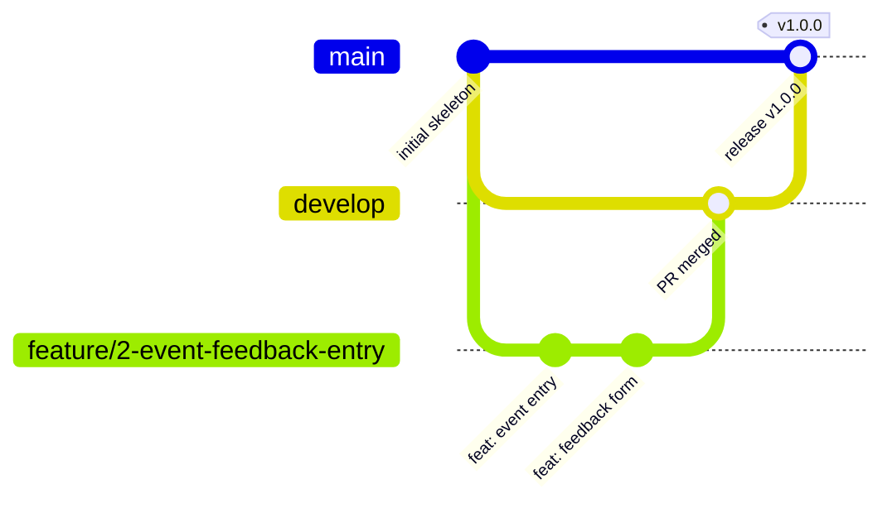

# Contributing and Branch Policy

## Branch model



| Branch | Purpose | Created from | Merges into | Direct push |
|--------|---------|--------------|-------------|-------------|
| `main` | Released, deployable code | – | – | **No** (PR only) |
| `develop` | Integration of finished features | `main` | `main` (release) | **No** (PR only) |
| `feature/<issue>-<name>` | One backlog task / user story | `develop` | `develop` | Yes (owner) |
| `bugfix/<issue>-<name>` | Defect found during a sprint | `develop` | `develop` | Yes (owner) |
| `hotfix/<issue>-<name>` | Urgent fix to a release | `main` | `main` **and** `develop` | Yes (owner) |
| `release/<version>` | Release preparation | `develop` | `main` and `develop` | Yes (release manager) |
| `docs/<name>`, `chore/<name>` | Documentation or tooling only | `develop` | `develop` | Yes (owner) |

## Branch naming rules

1. Lowercase letters, digits and hyphens only (kebab-case); `/` only after the type prefix.
2. Start with a type prefix: `feature/`, `bugfix/`, `hotfix/`, `release/`, `docs/` or `chore/`.
3. Include the GitHub issue number right after the prefix when one exists.
4. Keep it short: at most 50 characters.

Valid: `feature/2-event-feedback-entry`, `bugfix/18-rating-validation`, `release/1.0.0`
Invalid: `Feature/NewStuff`, `vijay-branch`, `fix`, `feature/event_entry`

## Commit messages (Conventional Commits)

```text
<type>(<scope>): <short summary in imperative mood>

<optional body: what and why>

Refs #<issue>
```

| Type | Use for |
|------|---------|
| `feat` | New functionality |
| `fix` | Bug fix |
| `test` | Adding or changing tests |
| `docs` | Documentation only |
| `build` | Maven / dependency changes |
| `ci` | Jenkins pipeline changes |
| `refactor` | Code change without behaviour change |
| `chore` | Repository housekeeping |

Example: `feat(feedback): validate ratings between 1 and 5`

## Pull request process

1. Pull the latest `develop`: `git checkout develop && git pull`.
2. Create a branch: `git checkout -b feature/<issue>-<name>`.
3. Commit small, meaningful steps; run `mvn clean verify` before pushing.
4. Push: `git push -u origin feature/<issue>-<name>`.
5. Open a PR **into `develop`** using the PR template; link the issue (`Closes #<issue>`).
6. At least one reviewer comments/approves; the author resolves every comment.
7. Merge with a **merge commit** (keeps the feature history visible), then delete or keep
   the branch for evidence.
8. Move the issue to **Done** (close it) – see the Definition of Done in
   [docs/02](docs/02-agile-planning-and-devops-workflow.md#6-definition-of-done).
