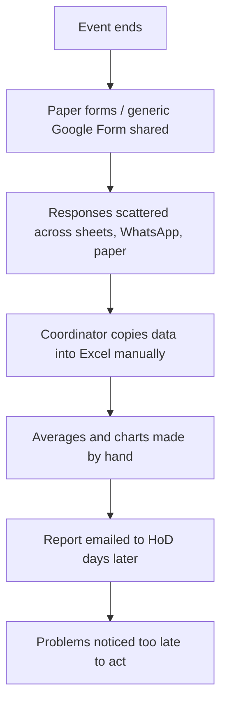

# Task 1 – Problem Definition and Scope

**Project:** Automated Event Feedback Dashboard
**Course:** DevOps
**Version:** 1.0 (scope frozen) · **Date:** 14-Oct-2026

---

## 1. Real-time need (study of the current situation)

Colleges and organisations run many events every semester: workshops, guest lectures,
seminars, hackathons, cultural and sports events, webinars. Collecting participant
feedback is mandatory (for quality improvement and for accreditation bodies such as
NAAC/NBA, which ask for documented feedback and action taken), but the way it is done today
is mostly manual.

### Current process ("as-is")

### Pain points observed

| # | Pain point | Effect |
|---|------------|--------|
| P1 | Feedback is collected on paper or in a separate form for every event | Data is scattered; nothing is comparable across events |
| P2 | Consolidation is manual (copy → Excel → charts) | 1–3 hours of work per event, and typing errors |
| P3 | Results are seen only days after the event | Issues raised during a multi-day event (sound, seating, timing) cannot be fixed while it is still running |
| P4 | No automatic flagging of bad ratings or complaints | Negative feedback gets buried among hundreds of responses |
| P5 | No single place to search history ("all workshops rated below 3 this year") | Management cannot see trends or compare organisers/speakers |
| P6 | No status tracking of complaints (who reviewed it, was it resolved?) | Accreditation evidence of "action taken" is missing |
| P7 | Releases of any in-house tool are done by hand | Slow, error-prone updates; "works on my machine" problems |

## 2. Problem statement

> Event organisers collect participant feedback on paper or in ad-hoc online forms and
> consolidate it by hand days after the event. As a result, problems are not visible in
> time to act, quality trends across events stay hidden, and preparing reports for
> management and accreditation takes hours of manual effort.
>
> **We will build an Automated Event Feedback Dashboard**: a web application where
> organisers register events, attendees submit structured feedback in under a minute, and
> a dashboard instantly shows searchable records, summary indicators, status-wise
> drill-down and an alert/exception view that automatically flags low ratings and
> negative comments. The application is built, tested and deployed through an automated
> DevOps pipeline (Git/GitHub → Jenkins → Maven → Tomcat).

## 3. Target users

| User | Who they are | What they need from the system |
|------|--------------|--------------------------------|
| **Attendee / Participant** | Students, faculty, external guests who attend an event | A quick form (≤ 1 min) on phone or laptop, optional anonymity |
| **Event Organiser / Coordinator** | Faculty or student coordinator who runs the event | Create events, see responses live, act on complaints, close alerts |
| **Department Head / Management** | HoD, Principal, IQAC cell | Summary indicators, comparison across events, exportable evidence |
| **DevOps / Operations** | Student team acting as the ops team | Automated build, test, deploy, health monitoring |

## 4. Stakeholder list

| Stakeholder | Role / interest | Influence | Involvement |
|-------------|-----------------|-----------|-------------|
| Faculty guide (Product Owner) | Approves scope, accepts sprint deliverables | High | Sprint review, scope sign-off |
| Event organisers / coordinators | Primary users of the dashboard and alert view | High | User stories, acceptance testing |
| Attendees / participants | Provide the feedback data | Medium | Usability of feedback form |
| HoD / IQAC / Management | Consume summary indicators and reports | High | Success criteria, reports |
| Speakers / resource persons | Receive feedback about their sessions | Low | Read-only summaries (future) |
| Development team (student team) | Design, code, test | High | All sprints |
| QA / testers (peer team) | Verify acceptance criteria | Medium | Review, test |
| DevOps / ops (student team) | Jenkins pipeline, Tomcat deployment, monitoring | High | Sprints 4–5 |
| College IT administrator | Owns the server / network where it would run | Medium | Deployment constraints |

## 5. Objectives

| ID | Objective | Measured by |
|----|-----------|-------------|
| O1 | Capture structured feedback quickly | Feedback form submitted in **< 60 s**, max 6 inputs |
| O2 | Remove manual consolidation | Summary indicators available **instantly** (0 min vs 1–3 h today) |
| O3 | Detect problems automatically | **100 %** of feedback with rating ≤ 2 or negative keywords raises an alert |
| O4 | Make history searchable | Search/filter on 1,000 records returns in **< 1 s** |
| O5 | Track follow-up | Every alert and complaint has a status (Open → Acknowledged → Resolved) |
| O6 | Deliver through an automated pipeline | Every push builds and tests in Jenkins; deploy to Tomcat in **< 5 min** with zero manual steps |

## 6. Constraints

| Type | Constraint |
|------|------------|
| Time | One semester; 5 one-week sprints for the MVP |
| Team | Small student team (1–4 members) |
| Budget | ₹0 – only free and open-source tools |
| Infrastructure | Single Windows 11 machine: Jenkins on port 8080, Tomcat 11 on port 8081, dev server on 8090 |
| Technology | Java 21, Spring Boot 3.5, Maven 3.9, Git/GitHub, Jenkins, Apache Tomcat 11, H2 database |
| Network | Must run fully on localhost; no paid cloud services |
| Security | MVP has no login (documented risk); no sensitive personal data is stored (name/email optional) |
| Data | Ratings on a fixed 1–5 scale; comments ≤ 1,000 characters |

## 7. Assumptions and risks

| # | Assumption / risk | Mitigation |
|---|-------------------|------------|
| R1 | No authentication in MVP – anyone on the network can open admin pages | Run only on localhost / college LAN; authentication is first item after MVP |
| R2 | H2 embedded DB is not meant for heavy production load | Data access through JPA, so moving to MySQL/PostgreSQL needs only config changes |
| R3 | Single machine for Jenkins and Tomcat | Different ports; document resource limits |
| R4 | Keyword-based negativity detection is simple and can miss sarcasm | Rule list is configurable; ML sentiment is out of scope |

## 8. Measurable success criteria

1. All **15 MVP tasks** below meet the Definition of Done (see Task 2).
2. An attendee can submit feedback in **under 60 seconds**.
3. Dashboard indicators reflect a new submission within **5 seconds** (on refresh/auto-refresh).
4. **100 %** of low-rating (≤ 2) submissions appear in the alert view automatically.
5. Search/filter responds in **< 1 second** for 1,000 feedback records.
6. Jenkins pipeline (build → test → package → deploy) finishes in **< 5 minutes** and is triggered without manual steps.
7. Automated test line coverage of the service layer **≥ 70 %**.
8. **Zero** open critical defects at the v1.0 release.

## 9. Approved MVP scope – 15 tasks (frozen)

The MVP covers the five modules required by the project brief:
**data/event entry · searchable dashboard · summary indicators · status drill-down · alert/exception view**,
plus the DevOps tasks needed to deliver them automatically.

| Task | Title | Module | Sprint |
|------|-------|--------|--------|
| T01 | Application skeleton (Spring Boot WAR, info/health endpoint, landing page) | Foundation | 1 |
| T02 | Event entry – create and list events | Data/event entry | 1 |
| T03 | Feedback submission form with validation and storage | Data/event entry | 1 |
| T04 | Search and filter events/feedback (keyword, status, category, date) | Searchable dashboard | 2 |
| T05 | Summary indicators API (events, responses, avg rating, satisfaction %, open alerts) | Summary indicators | 2 |
| T06 | Dashboard UI with KPI cards and auto-refresh | Searchable dashboard | 2 |
| T07 | Status drill-down (status count → event list → event detail with rating distribution) | Status drill-down | 3 |
| T08 | Feedback status workflow (New → Reviewed → Action required → Resolved) | Status drill-down | 3 |
| T09 | Automated alert rules (low rating, negative keywords, low event average) | Alert/exception view | 3 |
| T10 | Alert/exception view (filter, acknowledge, resolve) | Alert/exception view | 4 |
| T11 | Automated tests and coverage report (JUnit 5, MockMvc, JaCoCo) | Quality | 4 |
| T12 | Jenkins CI pipeline (checkout → build → test → package → archive) | DevOps | 4 |
| T13 | Automated deployment of WAR to Tomcat 11 with smoke test | DevOps | 5 |
| T14 | Monitoring and logging (Actuator health/metrics, log file) | Operations | 5 |
| T15 | Release v1.0 (tag, release notes, user guide, demo) | Release | 5 |

### Out of scope for the MVP

- Login, roles and single sign-on
- E-mail / SMS / WhatsApp notifications
- QR-code generation for feedback links
- Machine-learning sentiment analysis
- Native mobile app (the web UI is responsive instead)
- Multi-college / multi-tenant support
- PDF report export

### Scope approval

| Role | Name | Decision | Date |
|------|------|----------|------|
| Product Owner (Faculty guide) | _________________ | Approved / Changes requested | ____ |
| Team lead | _________________ | Submitted | 14-Oct-2026 |

> Any change to the 15 tasks after this sign-off goes through the backlog as a new item
> and is planned for a later sprint (scope freeze).
