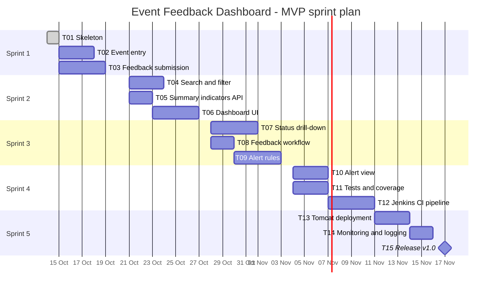
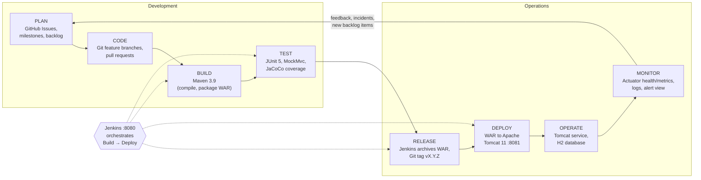
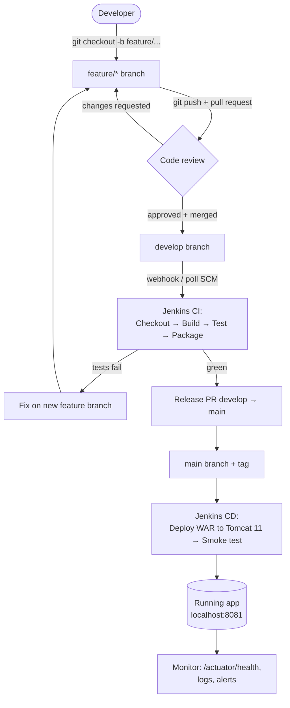

# Task 2 – Agile Planning and DevOps Workflow

**Project:** Automated Event Feedback Dashboard
**Method:** Scrum (5 one-week sprints) with a Kanban board for daily flow
**Live board:** GitHub Issues + Milestones (one milestone per sprint), see Task 4

---

## 1. User stories and acceptance criteria

Format: *As a &lt;role&gt;, I want &lt;goal&gt; so that &lt;benefit&gt;.* Acceptance criteria use Given / When / Then.

### US-01 · Application skeleton (T01)
*As a developer, I want a runnable project skeleton so that the team can start building features on a common base.*

- **Given** a fresh clone, **when** I run `mvn clean verify`, **then** the build succeeds and produces `event-feedback-dashboard.war`.
- **Given** the app is running, **when** I open `/api/info`, **then** I get the application name and version as JSON.
- **Given** the app is running, **when** I open `/actuator/health`, **then** the status is `UP`.

### US-02 · Event entry (T02)
*As an organiser, I want to register an event with title, category, date, venue and organiser so that attendees can give feedback on it.*

- **Given** the Events page, **when** I submit a valid event, **then** it is saved and appears in the event list without reloading the page.
- **Given** a missing title or date, **when** I submit, **then** the event is rejected with a clear field-level message (HTTP 400 from the API).
- **Given** saved events, **when** I open the Events page, **then** each event shows its status, number of responses and average rating.

### US-03 · Feedback submission (T03)
*As an attendee, I want to rate an event and leave a comment in under a minute so that organisers know my experience.*

- **Given** an event, **when** I give an overall rating (1–5), content and organisation ratings, a recommend yes/no and an optional comment, **then** my feedback is stored with status `NEW` and a timestamp.
- **Given** a rating outside 1–5 or a comment longer than 1,000 characters, **when** I submit, **then** I get a validation error and nothing is stored.
- **Given** I leave name and email empty, **when** I submit, **then** the feedback is stored anonymously.
- **Given** a cancelled event, **when** I try to submit feedback, **then** the submission is refused.

### US-04 · Search and filter (T04)
*As an organiser, I want to search events and feedback by keyword, status, category and date range so that I find relevant records quickly.*

- **Given** 1,000 feedback records, **when** I search by keyword, **then** matching records are returned in under 1 second.
- **Given** filters for status and category, **when** I combine them, **then** only records matching all filters are shown.

### US-05 · Summary indicators (T05, T06)
*As a department head, I want KPI cards (total events, total responses, average rating, satisfaction %, open alerts) so that I can judge event quality at a glance.*

- **Given** stored feedback, **when** I open the dashboard, **then** the five indicators are shown and match the data in the database.
- **Given** a new feedback submission, **when** the dashboard auto-refreshes (every 30 s) or I refresh, **then** the indicators include it.
- Satisfaction % = share of feedback with overall rating ≥ 4.

### US-06 · Status drill-down (T07)
*As an organiser, I want to click a status count and drill into the events and then into one event's detail so that I can analyse problems.*

- **Given** the status breakdown (Upcoming / Ongoing / Completed / Cancelled), **when** I click a status, **then** I see only events in that status.
- **Given** an event, **when** I open it, **then** I see its rating distribution (1–5), averages per category and all comments.

### US-07 · Feedback status workflow (T08)
*As an organiser, I want to mark feedback as Reviewed, Action required or Resolved so that follow-up is tracked.*

- **Given** a `NEW` feedback, **when** I change its status, **then** the new status and time are saved.
- **Given** a `RESOLVED` feedback, **when** I try to move it back to `NEW`, **then** the change is refused.

### US-08 · Automated alert rules (T09)
*As an organiser, I want the system to raise alerts automatically for low ratings and negative comments so that problems are never missed.*

- **Given** a submission with overall rating ≤ 2, **when** it is saved, **then** a `LOW_RATING` alert (severity HIGH) is created.
- **Given** a comment containing a configured negative keyword (e.g. "worst", "waste", "not audible"), **when** it is saved, **then** a `NEGATIVE_COMMENT` alert is created.
- **Given** an event whose average drops below 3.0 with at least 5 responses, **when** a new submission arrives, **then** a `LOW_AVERAGE` alert is created once per event.

### US-09 · Alert/exception view (T10)
*As an organiser, I want one screen listing all open alerts where I can acknowledge and resolve them so that every issue is closed.*

- **Given** open alerts, **when** I open the Alerts page, **then** they are listed newest first with severity colour, event and message.
- **Given** an alert, **when** I acknowledge or resolve it, **then** its status changes and resolved alerts leave the "open" count.

### US-10 · Automated tests (T11)
*As a developer, I want unit and API tests with a coverage report so that regressions are caught before merge.*

- **Given** a push, **when** `mvn verify` runs, **then** all tests pass and a JaCoCo report is produced.
- Service-layer line coverage is ≥ 70 %.

### US-11 · Jenkins CI pipeline (T12)
*As a DevOps engineer, I want Jenkins to build and test every change automatically so that `develop` and `main` are always green.*

- **Given** a commit on GitHub, **when** the Jenkins job runs, **then** stages Checkout → Build → Test → Package → Archive run and the WAR and test reports are archived.
- **Given** a failing test, **when** the pipeline runs, **then** the build is marked failed and nothing is deployed.

### US-12 · Automated deployment (T13)
*As a DevOps engineer, I want the WAR deployed to Tomcat 11 automatically with a smoke test so that releases need no manual steps.*

- **Given** a green build on `main`, **when** the Deploy stage runs, **then** the WAR is deployed to Tomcat (port 8081) and `/actuator/health` returns `UP` within 60 s.

### US-13 · Monitoring and logging (T14)
*As an operator, I want health/metrics endpoints and a log file so that I can see whether the app is healthy.*

- `/actuator/health` and `/actuator/metrics` are reachable; application logs are written to a rolling file.

### US-14 · Release v1.0 (T15)
*As the product owner, I want a tagged release with notes and a user guide so that the MVP can be demonstrated and handed over.*

- Git tag `v1.0.0` exists, GitHub release has notes, README contains the user guide.

---

## 2. Product backlog

Priority uses **MoSCoW**; size in **story points** (Fibonacci).

| Rank | Task | Story | Title | Priority | Points | Sprint |
|-----:|------|-------|-------|----------|-------:|:------:|
| 1 | T01 | US-01 | Application skeleton | Must | 2 | 1 |
| 2 | T02 | US-02 | Event entry – create and list events | Must | 3 | 1 |
| 3 | T03 | US-03 | Feedback submission with validation | Must | 5 | 1 |
| 4 | T04 | US-04 | Search and filter | Must | 5 | 2 |
| 5 | T05 | US-05 | Summary indicators API | Must | 3 | 2 |
| 6 | T06 | US-05 | Dashboard UI with KPI cards | Must | 5 | 2 |
| 7 | T07 | US-06 | Status drill-down | Must | 5 | 3 |
| 8 | T08 | US-07 | Feedback status workflow | Should | 3 | 3 |
| 9 | T09 | US-08 | Automated alert rules | Must | 5 | 3 |
| 10 | T10 | US-09 | Alert/exception view | Must | 3 | 4 |
| 11 | T11 | US-10 | Automated tests + JaCoCo | Must | 3 | 4 |
| 12 | T12 | US-11 | Jenkins CI pipeline | Must | 5 | 4 |
| 13 | T13 | US-12 | Automated deployment to Tomcat | Must | 5 | 5 |
| 14 | T14 | US-13 | Monitoring and logging | Should | 2 | 5 |
| 15 | T15 | US-14 | Release v1.0 | Must | 2 | 5 |
| | | | **Total** | | **56** | |

**Change requests accepted after the scope freeze**

| Rank | Item | Story | Title | Priority | Points | Sprint |
|-----:|------|-------|-------|----------|-------:|:------:|
| 3a | CR-01 ([#20](https://github.com/vijayyh/event-feedback-dashboard/issues/20)) | US-15 | Organiser/attendee roles, status tabs, event feedback page, light theme | Must | 8 | 1 |

> **US-15** – *As an attendee, I want to browse events and read their ratings and feedback without being able to
> create events, and as an organiser, I want a signed-in area to create events and manage their status, so that
> the two roles are not confused.* Acceptance criteria are listed in issue #20.

**Icebox (after MVP):** multiple organiser accounts · e-mail notification of HIGH alerts · QR code per event ·
CSV/PDF export · MySQL profile for production · Docker image.

---

## 3. Task board (Kanban)

Columns and WIP limits: **Backlog → To Do → In Progress (WIP 2) → Review / PR (WIP 2) → Done**.
Snapshot at the start of Sprint 1:

| Backlog | To Do (Sprint 1) | In Progress | Review / PR | Done |
|---------|------------------|-------------|-------------|------|
| T04 Search & filter | T01 Skeleton | | | |
| T05 Summary API | T02 Event entry | | | |
| T06 Dashboard UI | T03 Feedback submission | | | |
| T07 Drill-down | | | | |
| T08 Feedback workflow | | | | |
| T09 Alert rules | | | | |
| T10 Alert view | | | | |
| T11 Tests + coverage | | | | |
| T12 Jenkins CI | | | | |
| T13 Tomcat deploy | | | | |
| T14 Monitoring | | | | |
| T15 Release v1.0 | | | | |

On GitHub the board is kept with **labels** (`status: todo`, `status: in-progress`, `status: review`)
and **milestones** (`Sprint 1` … `Sprint 5`); an issue is closed when it reaches Done.

### Board at release v0.9.0 (14-Oct-2026, Task 6)

All functional MVP items are **Done**; the remaining items are the DevOps pipeline work of Tasks 7–10 and the v1.0 release.

| To Do | In Progress | Review / PR | Done |
|-------|-------------|-------------|------|
| T11 Tests + coverage (#11) | | | T01 Skeleton (#1) |
| T12 Jenkins CI (#12) | | | T02 Event entry (#2) |
| T13 Tomcat deploy (#13) | | | T03 Feedback submission (#3) |
| T14 Monitoring (#14) | | | CR-01 Roles, tabs, feedback page, theme (#20) |
| T15 Release v1.0 (#15) | | | T04 Search and filter (#4) |
| | | | T05 Summary indicators API (#5) |
| | | | T06 Dashboard UI (#6) |
| | | | T07 Status drill-down (#7) |
| | | | T08 Feedback workflow (#8) |
| | | | T09 Alert rules (#9) |
| | | | T10 Alert view (#10) |
| | | | Bugs #17, #24 |

**Velocity:** 39 of 56 MVP points + 8 points of CR-01 delivered. Planned sprints 2–3 work was pulled forward
because both feature branches were developed in parallel (see [Task 6](06-mvp-completion-and-collaboration.md)).

---

## 4. Sprint plan

Sprint length 1 week · capacity ≈ 12 points/sprint · sprint review with the Product Owner at the end of each sprint.

| Sprint | Dates | Sprint goal | Tasks | Points |
|--------|-------|-------------|-------|-------:|
| 1 | 14 Oct – 20 Oct 2026 | Events can be registered and feedback can be submitted (Feature 1) | T01, T02, T03 | 10 |
| 2 | 21 Oct – 27 Oct 2026 | Searchable dashboard with live summary indicators | T04, T05, T06 | 13 |
| 3 | 28 Oct – 03 Nov 2026 | Drill-down, feedback workflow and automatic alert generation | T07, T08, T09 | 13 |
| 4 | 04 Nov – 10 Nov 2026 | Alert view, automated tests and Jenkins CI pipeline | T10, T11, T12 | 11 |
| 5 | 11 Nov – 17 Nov 2026 | Automated Tomcat deployment, monitoring and v1.0 release | T13, T14, T15 | 9 |

**Scrum events:** sprint planning (Monday, 30 min) · daily stand-up (10 min) · sprint review
with demo (Sunday) · retrospective (15 min).

---

## 5. Definition of Ready (story can enter a sprint)

- User story written with role, goal and benefit.
- Acceptance criteria agreed with the Product Owner.
- Estimated in story points and small enough to finish in one sprint.
- Dependencies identified (e.g. T09 needs T03).

## 6. Definition of Done

A task is **Done** only when **all** of these are true:

1. Code is on a `feature/*` branch and merged into `develop` through a **pull request**.
2. The PR has at least **one review** and all review comments are resolved.
3. `mvn clean verify` passes locally **and** in Jenkins (from Sprint 4).
4. New logic has **unit/API tests**; all tests are green; coverage does not go down.
5. Every acceptance criterion of the story has been demonstrated.
6. No secrets, passwords or machine-specific paths are committed.
7. API list and README are updated when endpoints or setup change.
8. The WAR runs on Tomcat 11 (verified manually until T13, automatically after).
9. The GitHub issue is linked to the PR, closed, and the board shows it in **Done**.

---

## 7. DevOps lifecycle – from development to operations

### Branch and pipeline flow

### Tool chain per stage

| Stage | Tool | Output / evidence |
|-------|------|-------------------|
| Plan | GitHub Issues, Milestones, Labels | Backlog, sprint milestones, task board |
| Code | Git, GitHub, feature branches, PRs | Commits, PR with review comments |
| Build | Apache Maven 3.9, JDK 21 | `target/event-feedback-dashboard.war` |
| Test | JUnit 5, Spring MockMvc, JaCoCo | Surefire reports, coverage report |
| Integrate | Jenkins (Pipeline / Jenkinsfile) | Build history, archived artefacts |
| Deploy | Apache Tomcat 11 (port 8081) | Deployed `/event-feedback-dashboard` context |
| Operate | Tomcat service, H2 file database | Running application |
| Monitor | Spring Boot Actuator, log files, in-app alert view | Health `UP`, metrics, alert list |
