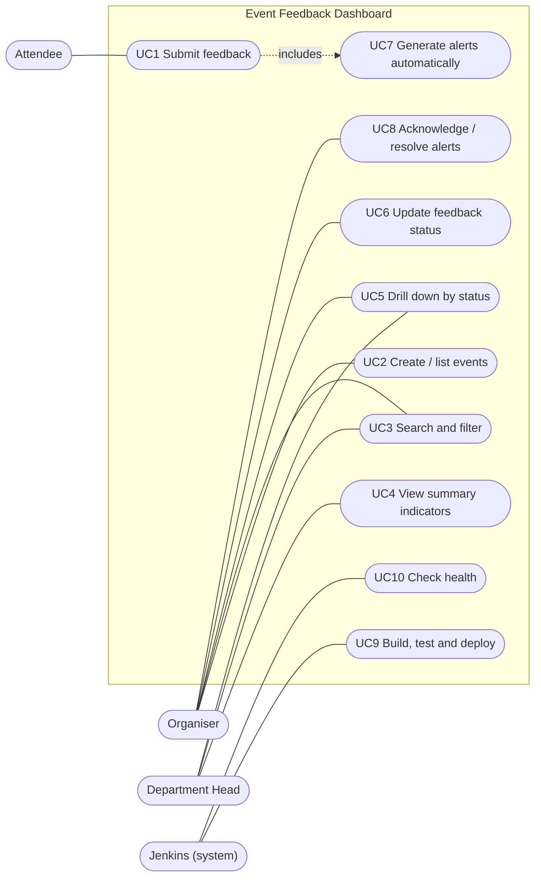
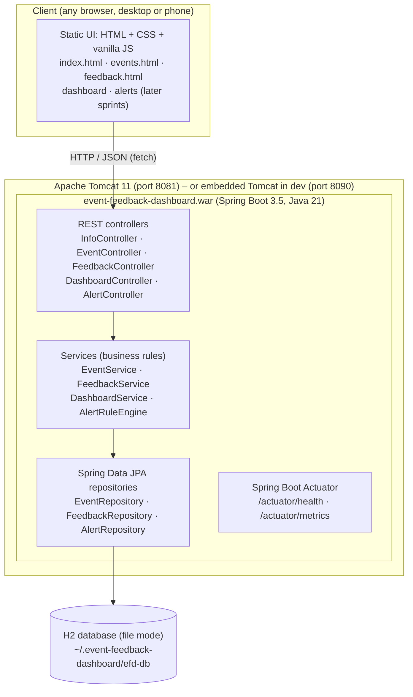
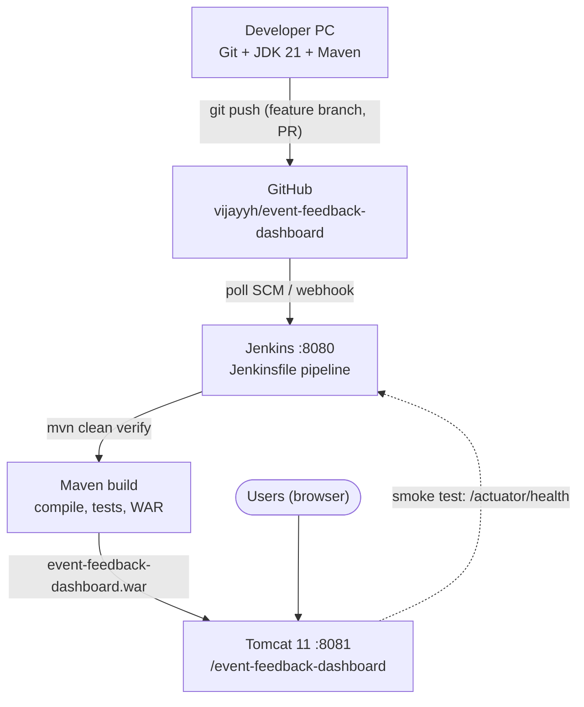
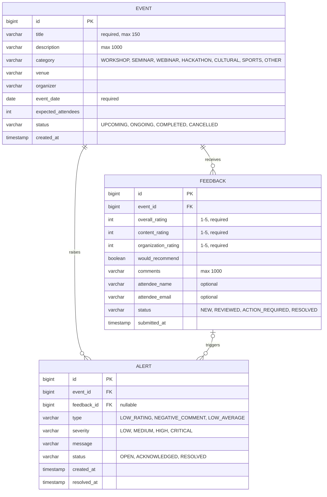

# Task 3 – Requirements, Architecture and Technology Setup

**Project:** Automated Event Feedback Dashboard

---

## 1. SRS summary

### 1.1 Purpose
A web application that lets organisers register events, lets attendees submit structured
feedback, and gives organisers and management a searchable dashboard with summary
indicators, status drill-down and an automatically maintained alert/exception view.

### 1.2 Users
Attendee · Organiser · Department head / management · Jenkins (system actor for build/deploy).

### 1.3 Functional requirements

| ID | Requirement | Module | Task |
|----|-------------|--------|------|
| FR-01 | The system shall let an organiser create an event (title, description, category, venue, organiser, date, expected attendees, status). | Event entry | T02 |
| FR-02 | The system shall list events with status, response count and average rating. | Event entry | T02 |
| FR-03 | The system shall let an attendee submit feedback for an event: overall, content and organisation ratings (1–5), would-recommend, comment (≤ 1,000 chars), optional name/email. | Event entry | T03 |
| FR-04 | The system shall validate all inputs and reject invalid data with field-level messages. | Event entry | T02, T03 |
| FR-05 | The system shall search events/feedback by keyword and filter by status, category and date range. | Searchable dashboard | T04 |
| FR-06 | The system shall compute summary indicators: total events, total responses, average rating, satisfaction %, open alerts. | Summary indicators | T05 |
| FR-07 | The dashboard shall show indicators as KPI cards and refresh automatically every 30 s. | Searchable dashboard | T06 |
| FR-08 | The system shall show counts per event status and drill down to the event list and to an event's detail (rating distribution, comments). | Status drill-down | T07 |
| FR-09 | The system shall let an organiser move feedback through New → Reviewed → Action required → Resolved. | Status drill-down | T08 |
| FR-10 | The system shall automatically create alerts for rating ≤ 2, negative keywords and event average < 3.0 (min. 5 responses). | Alert/exception view | T09 |
| FR-11 | The system shall list alerts by severity/status and allow acknowledge and resolve. | Alert/exception view | T10 |
| FR-12 | The system shall expose health and metrics endpoints for monitoring. | Operations | T14 |

### 1.4 Non-functional requirements

| ID | Category | Requirement |
|----|----------|-------------|
| NFR-01 | Performance | Search/filter on 1,000 records < 1 s; page load < 2 s on localhost |
| NFR-02 | Usability | Feedback form usable on a phone; ≤ 6 inputs; submission < 60 s |
| NFR-03 | Reliability | Data persisted in a file database; survives restarts |
| NFR-04 | Maintainability | Layered architecture (controller → service → repository); ≥ 70 % service-layer test coverage |
| NFR-05 | Portability | Single WAR runs on embedded Tomcat (dev) and external Tomcat 11 (deploy) |
| NFR-06 | Security | Server-side validation of all inputs; output escaped in UI; no secrets in Git |
| NFR-07 | Deployability | Build, test and deploy fully automated through Jenkins in < 5 min |
| NFR-08 | Observability | `/actuator/health` returns status; logs written to file |

---

## 2. Use-case diagram



| Use case | Primary actor | Main success scenario |
|----------|---------------|-----------------------|
| UC1 Submit feedback | Attendee | Opens form → picks event → rates → submits → sees confirmation; alerts evaluated (UC7) |
| UC2 Create / list events | Organiser | Fills event form → saved → appears in list with response count |
| UC3 Search and filter | Organiser, Head | Enters keyword/filters → matching events and feedback shown |
| UC4 View summary indicators | Head | Opens dashboard → KPI cards shown, auto-refresh |
| UC5 Drill down by status | Organiser, Head | Clicks status count → event list → event detail |
| UC6 Update feedback status | Organiser | Changes status of a feedback item |
| UC7 Generate alerts | System | Rules run on every submission → alert stored |
| UC8 Acknowledge / resolve alerts | Organiser | Opens alert view → acknowledges / resolves |
| UC9 Build, test and deploy | Jenkins | Pulls repo → Maven build → tests → deploys WAR to Tomcat |
| UC10 Check health | Jenkins / operator | Calls `/actuator/health` after deploy |

---

## 3. Architecture

### 3.1 Minimum application architecture



**Why this shape:** a single deployable WAR keeps the MVP simple to build and deploy with
Maven + Jenkins + Tomcat; the REST API separates the UI from the logic so the UI or the
database can be replaced later without touching the business rules.

### 3.2 DevOps / deployment architecture



### 3.3 Technology selection

| Concern | Choice | Reason |
|---------|--------|--------|
| Language | **Java 21 (LTS)** | Installed (`C:\DevTools\jdk-21`), long-term support |
| Framework | **Spring Boot 3.5.16** | Production-ready REST, JPA, validation, Actuator; builds a WAR for Tomcat |
| Build tool | **Apache Maven 3.9.16** | Standard lifecycle (`validate → compile → test → package → verify`), first-class Jenkins support. Gradle 9.6 and Ant are also installed but Maven is the simplest fit for a WAR + Jenkins |
| Database | **H2 2.x, file mode** | Zero install, no passwords, survives restarts; JPA makes a later switch to MySQL 8 (installed) a config change |
| Deployment target | **Apache Tomcat 11** (port 8081) | Already installed as a Windows service; standard servlet container for WARs. Nginx is not needed for a single-node MVP |
| UI | **HTML5 + CSS + vanilla JavaScript** | No extra build step, works inside the WAR, responsive for phones |
| Tests | **JUnit 5, Spring MockMvc**, JaCoCo (T11) | Included with Spring Boot test starter |
| CI/CD | **Jenkins** (port 8080) | Already installed; pipeline as code in a `Jenkinsfile` |
| VCS | **Git + GitHub** | Branching, pull requests, issues, milestones |

---

## 4. Data model



`EVENT` and `FEEDBACK` are built in Sprint 1 (Feature 1). `ALERT` is added in Sprint 3 (T09).

---

## 5. API list

Base path: `/` (embedded dev server, port 8090) or `/event-feedback-dashboard/` (Tomcat, port 8081).
All bodies are JSON.

| # | Method | Endpoint | Purpose | Task | Sprint |
|---|--------|----------|---------|------|:------:|
| 1 | GET | `/api/info` | Application name, version, time | T01 | 1 |
| 2 | GET | `/actuator/health` | Health check (`UP`/`DOWN`) | T01 | 1 |
| 3 | GET | `/api/events` | List events with response count and average rating | T02 | 1 |
| 4 | POST | `/api/events` | Create an event | T02 | 1 |
| 5 | GET | `/api/events/{id}` | One event with its statistics | T02 | 1 |
| 6 | POST | `/api/events/{id}/feedback` | Submit feedback for an event | T03 | 1 |
| 7 | GET | `/api/events/{id}/feedback` | List feedback of an event (newest first) | T03 | 1 |
| 8 | GET | `/api/events?q=&status=&category=&from=&to=` | Search/filter events | T04 | 2 |
| 9 | GET | `/api/feedback?q=&status=&eventId=&maxRating=` | Search/filter feedback | T04 | 2 |
| 10 | GET | `/api/dashboard/summary` | KPI indicators | T05 | 2 |
| 11 | GET | `/api/dashboard/status-breakdown` | Event and feedback counts per status | T07 | 3 |
| 12 | GET | `/api/events/{id}/summary` | Rating distribution and averages for one event | T07 | 3 |
| 13 | PATCH | `/api/events/{id}/status` | Change event status | T07 | 3 |
| 14 | PATCH | `/api/feedback/{id}/status` | Change feedback status | T08 | 3 |
| 15 | GET | `/api/alerts?status=&severity=` | List alerts | T10 | 4 |
| 16 | PATCH | `/api/alerts/{id}` | Acknowledge / resolve an alert | T10 | 4 |
| 17 | GET | `/actuator/metrics` | JVM / HTTP metrics | T14 | 5 |

Errors follow one shape:

```json
{ "status": 400, "error": "Validation failed", "fieldErrors": { "title": "must not be blank" } }
```

---

## 6. Local development setup

### 6.1 Installed on the development machine (verified 14-Oct-2026)

| Tool | Version | Location / port |
|------|---------|-----------------|
| JDK | OpenJDK 21.0.12 | `C:\DevTools\jdk-21` (`JAVA_HOME`) |
| Maven | 3.9.16 | `C:\DevTools\apache-maven-3.9.16` |
| Gradle / Ant | 9.6.1 / installed | `C:\DevTools` (not used) |
| Git | 2.47.1 | `C:\Program Files\Git` |
| GitHub CLI | 2.102.0 | `C:\Program Files\GitHub CLI` |
| Jenkins | Windows service | http://localhost:8080 |
| Apache Tomcat | 11.0 (service `Tomcat11`) | http://localhost:8081 |
| MySQL / PostgreSQL | 8.0 / 17 (installed, not used by MVP) | 3306 / 5432 |

### 6.2 Run locally

```bash
git clone https://github.com/vijayyh/event-feedback-dashboard.git
cd event-feedback-dashboard
mvn clean verify          # compile, run tests, build target/event-feedback-dashboard.war
mvn spring-boot:run       # start on http://localhost:8090
```

Check: `http://localhost:8090/api/info` and `http://localhost:8090/actuator/health`.

### 6.3 Deploy to Tomcat 11 (manual, until Jenkins automates it in T13)

```bash
copy target\event-feedback-dashboard.war "C:\Program Files\Apache Software Foundation\Tomcat 11.0\webapps\"
```

Then open `http://localhost:8081/event-feedback-dashboard/`.

### 6.4 Ports used

| Port | Service |
|------|---------|
| 8080 | Jenkins |
| 8081 | Tomcat 11 (deployed WAR) |
| 8090 | Spring Boot embedded server (development) |
