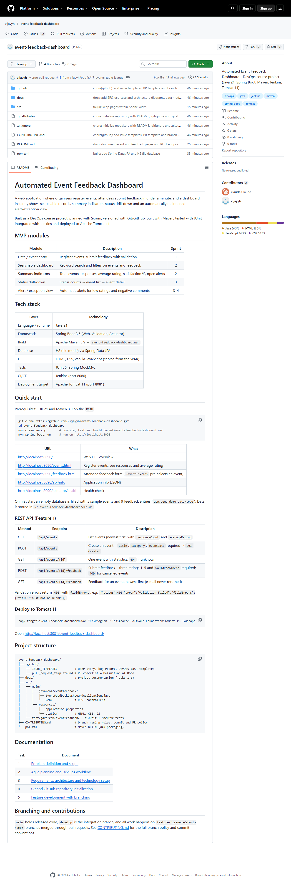
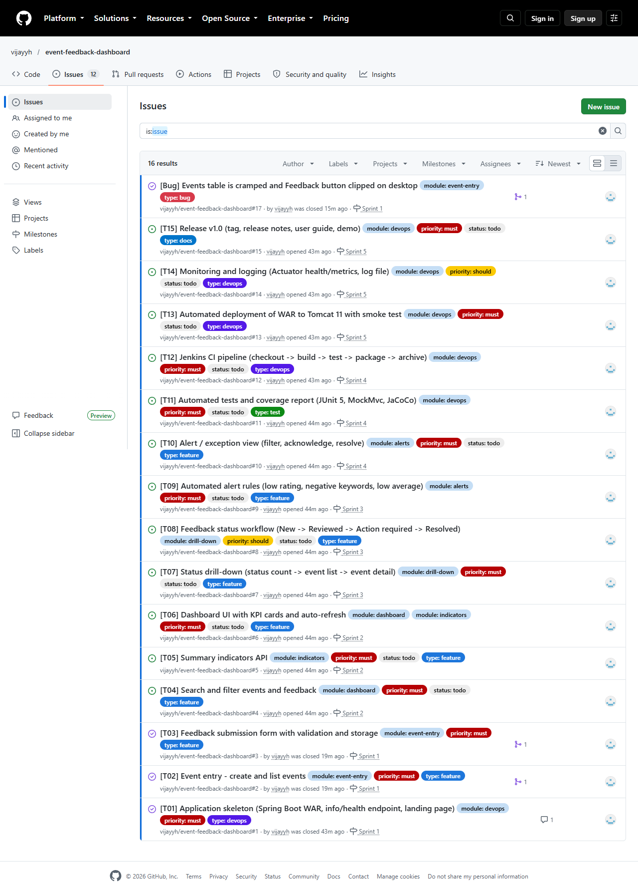

# Task 4 – Git and GitHub Repository Initialization

**Project:** Automated Event Feedback Dashboard · **Date:** 14-Oct-2026

---

## 1. Repository

| Item | Value |
|------|-------|
| URL | **https://github.com/vijayyh/event-feedback-dashboard** |
| Visibility | Public |
| Default branch | `develop` (integration branch – PRs target it, `Closes #n` closes issues on merge) |
| Release branch | `main` |
| Description | Automated Event Feedback Dashboard – DevOps course project (Java 21, Spring Boot, Maven, Jenkins, Tomcat 11) |
| Topics | `devops` `java` `jenkins` `maven` `spring-boot` `tomcat` |



## 2. Commands used

```bash
# local repository and identity (GitHub no-reply address keeps the real e-mail private)
git init -b main
git config user.name  "vijayyh"
git config user.email "189359363+vijayyh@users.noreply.github.com"

# one commit per logical step (see section 4)
git add README.md .gitignore .gitattributes
git commit -m "chore: initialize repository with README, .gitignore and .gitattributes"
# ... 7 more commits ...

# GitHub repository and first push
gh auth login --web
gh repo create vijayyh/event-feedback-dashboard --public --description "Automated Event Feedback Dashboard - ..."
git remote add origin https://github.com/vijayyh/event-feedback-dashboard.git
git push -u origin main

# integration branch
git checkout -b develop
git push -u origin develop
gh repo edit vijayyh/event-feedback-dashboard --default-branch develop
```

## 3. README, .gitignore and folder structure

| File | Purpose |
|------|---------|
| [`README.md`](../README.md) | Overview, MVP modules, tech stack, quick start, project structure, links to all task documents |
| [`.gitignore`](../.gitignore) | Ignores `target/`, IDE folders, logs, local H2 database files (`*.mv.db`) and local secrets (`.env`, `application-local.properties`) |
| [`.gitattributes`](../.gitattributes) | Normalises line endings (LF in the repo, CRLF for `.bat/.cmd/.ps1`), marks binaries |
| [`CONTRIBUTING.md`](../CONTRIBUTING.md) | Branch policy, naming rules, commit convention, PR process |

```text
event-feedback-dashboard/
├── .github/
│   ├── ISSUE_TEMPLATE/           user-story.md · bug-report.md · devops-task.md · config.yml
│   └── pull_request_template.md  PR checklist = Definition of Done
├── docs/                         Task 1–5 documents and images
├── src/main/java/com/eventfeedback/
│   ├── EventFeedbackDashboardApplication.java   Spring Boot + WAR initializer
│   └── web/InfoController.java                  GET /api/info
├── src/main/resources/
│   ├── application.properties
│   └── static/                   index.html · css/app.css · js/common.js
├── src/test/java/com/eventfeedback/   context-load and endpoint tests
├── CONTRIBUTING.md
└── pom.xml                       Maven, packaging = war
```

## 4. Initial commits (application skeleton on `main`)

Commit messages follow **Conventional Commits** (`type(scope): summary`).

| # | Commit | Message |
|---|--------|---------|
| 1 | `00b24c6` | chore: initialize repository with README, .gitignore and .gitattributes |
| 2 | `c495d7e` | docs: add problem definition and frozen 15-task MVP scope (Task 1) |
| 3 | `60946bf` | docs: add user stories, backlog, sprint plan, DoD and DevOps workflow (Task 2) |
| 4 | `7c8c66c` | docs: add SRS, use-case and architecture diagrams, data model and API list (Task 3) |
| 5 | `df9ca29` | build: add Maven WAR build with Spring Boot 3.5 and Java 21 |
| 6 | `72a1797` | feat: add application skeleton with info endpoint and landing page (`Closes #1`) |
| 7 | `c50d69a` | test: add context-load and info/health endpoint tests |
| 8 | `f775464` | chore(github): add issue templates, PR template and branch policy |

Skeleton verified with `mvn clean verify`: 2 tests passed, `target/event-feedback-dashboard.war` built.

## 5. Issues, labels and milestones (backlog on GitHub)

The 15 MVP tasks from Task 1/2 were created as issues **#1–#15** (T01–T15), each with the user
story, Given/When/Then acceptance criteria as a checklist, story points, priority and the
Definition of Done.

| Labels | Values |
|--------|--------|
| Type | `type: feature` · `type: devops` · `type: test` · `type: docs` · `type: bug` |
| Priority (MoSCoW) | `priority: must` · `priority: should` |
| Module | `module: event-entry` · `module: dashboard` · `module: indicators` · `module: drill-down` · `module: alerts` · `module: devops` |
| Kanban status | `status: todo` · `status: in-progress` · `status: review` (closed = Done) |

| Milestone | Due | Issues |
|-----------|-----|--------|
| Sprint 1 | 20-Oct-2026 | #1 T01, #2 T02, #3 T03 (+ bug #17) – **all closed** |
| Sprint 2 | 27-Oct-2026 | #4 T04, #5 T05, #6 T06 |
| Sprint 3 | 03-Nov-2026 | #7 T07, #8 T08, #9 T09 |
| Sprint 4 | 10-Nov-2026 | #10 T10, #11 T11, #12 T12 |
| Sprint 5 | 17-Nov-2026 | #13 T13, #14 T14, #15 T15 |



### Templates

- **Issue templates** (`.github/ISSUE_TEMPLATE/`): *User story / feature task*, *Bug report*,
  *DevOps / pipeline task*; blank issues disabled so every issue follows a template.
- **Pull request template** (`.github/pull_request_template.md`): summary, linked issue,
  type of change, how it was tested and the Definition of Done checklist.

## 6. Branch policy

Full rules: [CONTRIBUTING.md](../CONTRIBUTING.md).

| Branch | Purpose | From → into |
|--------|---------|-------------|
| `main` | Released code | – |
| `develop` | Integration (default branch) | `main` → `main` on release |
| `feature/<issue>-<name>` | One backlog task | `develop` → `develop` |
| `bugfix/<issue>-<name>` | Sprint defect | `develop` → `develop` |
| `hotfix/<issue>-<name>` | Urgent production fix | `main` → `main` + `develop` |
| `release/<version>` | Release preparation | `develop` → `main` + `develop` |
| `docs/<name>`, `chore/<name>` | Docs / tooling only | `develop` → `develop` |

**Naming rules:** lowercase kebab-case, type prefix, issue number first, max 50 characters
(e.g. `feature/2-event-feedback-entry`, `bugfix/17-events-table-layout`).

### Branch protection (enforced on GitHub for `main` and `develop`)

| Rule | Setting |
|------|---------|
| Require a pull request before merging | On (no direct pushes, also for admins) |
| Required approvals | 0 (single-member team; review comments are still required by the DoD) |
| Dismiss stale reviews on new commits | On |
| Require conversation resolution before merging | On |
| Allow force pushes | Off |
| Allow deletions | Off |

Applied with the GitHub REST API:

```bash
gh api -X PUT repos/vijayyh/event-feedback-dashboard/branches/develop/protection --input protection.json
```

```json
{
  "required_status_checks": null,
  "enforce_admins": true,
  "required_pull_request_reviews": { "required_approving_review_count": 0, "dismiss_stale_reviews": true },
  "restrictions": null,
  "required_conversation_resolution": true,
  "allow_force_pushes": false,
  "allow_deletions": false
}
```

When the Jenkins pipeline exists (T12) the Jenkins build will be added as a **required status check**.

## 7. Deliverables checklist

| Deliverable | Evidence |
|-------------|----------|
| Repository URL | https://github.com/vijayyh/event-feedback-dashboard |
| README | [README.md](../README.md) |
| Initial commits | Section 4 · [commit history](https://github.com/vijayyh/event-feedback-dashboard/commits/main) |
| Issues | [Issues #1–#15](https://github.com/vijayyh/event-feedback-dashboard/issues?q=is%3Aissue) · [milestones](https://github.com/vijayyh/event-feedback-dashboard/milestones?state=all) |
| Branch policy | [CONTRIBUTING.md](../CONTRIBUTING.md) + branch protection (section 6) |
