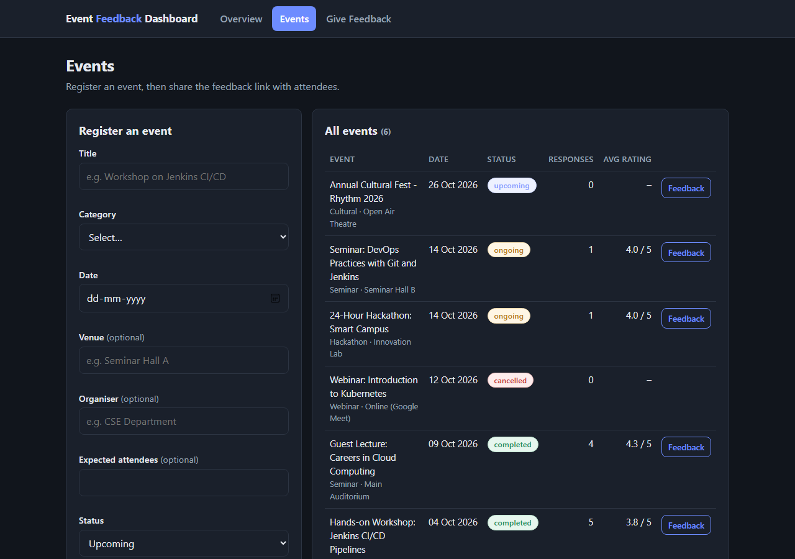
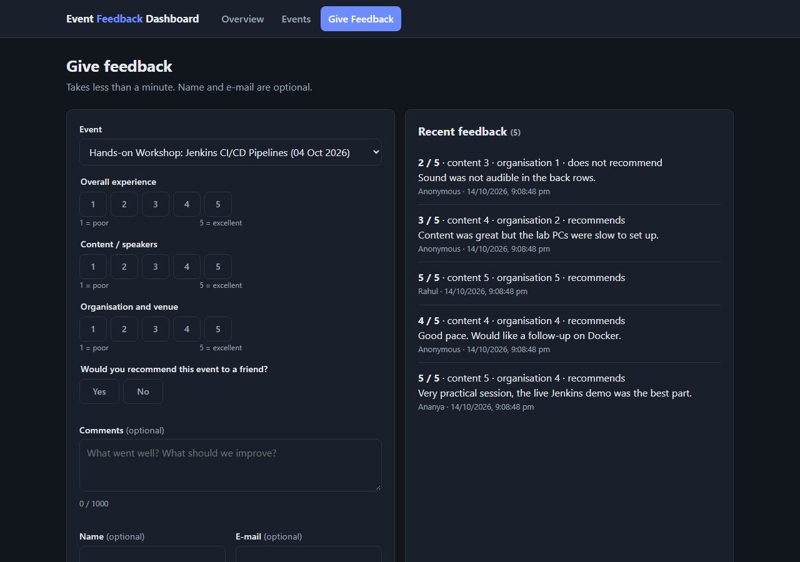
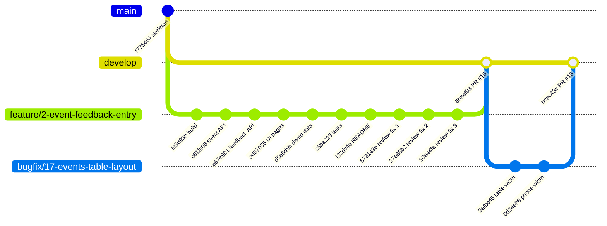
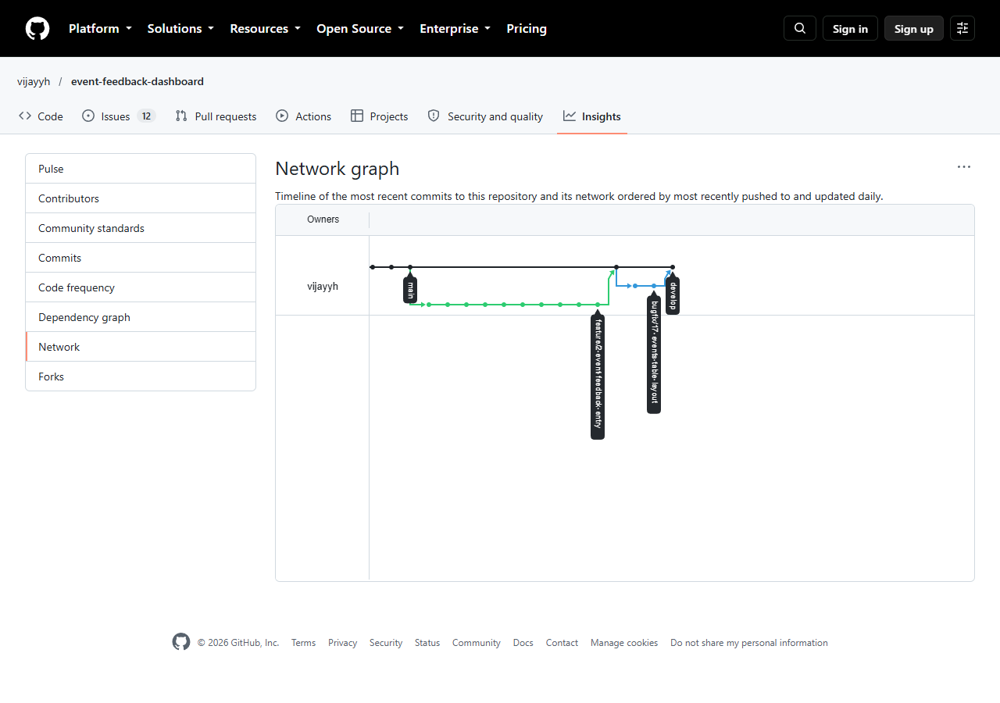
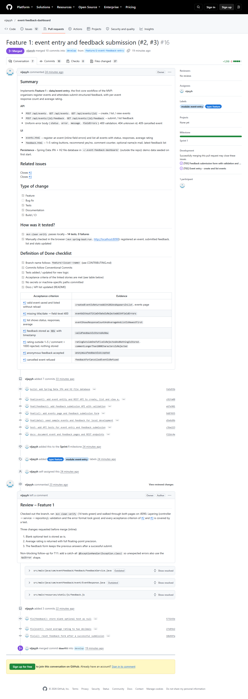

# Task 5 – Feature Development with Branching

**Project:** Automated Event Feedback Dashboard · **Date:** 14-Oct-2026
**Feature 1:** data/event entry – organisers register events, attendees submit feedback (issues **#2** and **#3**)

---

## 1. What was built

| Layer | Delivered |
|-------|-----------|
| REST API | `POST/GET /api/events`, `GET /api/events/{id}`, `POST/GET /api/events/{id}/feedback`; uniform error body; 400 validation, 404 unknown id, 409 cancelled event |
| Business rules | Ratings 1–5, comment ≤ 1,000 chars, optional name/e-mail (anonymous feedback), no feedback for cancelled events, feedback stored as `NEW` with timestamp, e-mail never returned |
| Statistics | Response count and average rating (2 decimals) per event |
| Persistence | Spring Data JPA, H2 file database in `~/.event-feedback-dashboard/`; demo data seeded on first start |
| UI | `events.html` (register + list events), `feedback.html` (rating buttons, comment counter, latest feedback) |
| Tests | 14 new MockMvc API tests → **16 tests in total, all passing** |

| Events page | Feedback page |
|-------------|---------------|
|  |  |

## 2. Branching flow (actual history)





## 3. Git commands used (with output)

**Create the feature branch from the latest `develop`**

```text
$ git checkout develop
$ git pull --ff-only
Already up to date.
$ git checkout -b feature/2-event-feedback-entry
Switched to a new branch 'feature/2-event-feedback-entry'
```

**add / commit** – one commit per logical step, e.g.

```text
$ git add pom.xml src/main/resources/application.properties src/test
$ git commit -m "build: add Spring Data JPA and H2 file database" -m "... Refs #2"
$ git add src/main/java/com/eventfeedback/event src/main/java/com/eventfeedback/common
$ git commit -m "feat(event): add event entity and REST API to create, list and view events" -m "... Refs #2"
```

**pull** – sync with `develop` before opening the PR

```text
$ git pull origin develop
From https://github.com/vijayyh/event-feedback-dashboard
 * branch            develop    -> FETCH_HEAD
Already up to date.
```

**push**

```text
$ git push -u origin feature/2-event-feedback-entry
remote: Create a pull request for 'feature/2-event-feedback-entry' on GitHub by visiting:
remote:      https://github.com/vijayyh/event-feedback-dashboard/pull/new/feature/2-event-feedback-entry
branch 'feature/2-event-feedback-entry' set up to track 'origin/feature/2-event-feedback-entry'.
 * [new branch]      feature/2-event-feedback-entry -> feature/2-event-feedback-entry
```

**log** – after the merge (`git checkout develop && git pull`)

```text
$ git log --oneline --graph --decorate
*   6baef93 (HEAD -> develop, origin/develop) Merge pull request #16 from vijayyh/feature/2-event-feedback-entry
|\
| * 10e44fa fix(ui): reset feedback form after a successful submission
| * 27e85b2 fix(event): round average rating to two decimals
| * 573143e fix(feedback): store blank optional text as null
| * f22dc4e docs: document event and feedback pages and REST endpoints
| * c5ba223 test: add API tests for event entry and feedback submission
| * d5e6d9b feat(data): seed sample events and feedback for local development
| * 9d87035 feat(ui): add events page and feedback submission form
| * e67e901 feat(feedback): add feedback submission API with validation
| * c81fa08 feat(event): add event entity and REST API to create, list and view events
| * fa5d93b build: add Spring Data JPA and H2 file database
|/
* f775464 (origin/main, main) chore(github): add issue templates, PR template and branch policy
```

## 4. Pull request

| Item | Value |
|------|-------|
| PR | [#16 – Feature 1: event entry and feedback submission (#2, #3)](https://github.com/vijayyh/event-feedback-dashboard/pull/16) |
| Base ← head | `develop` ← `feature/2-event-feedback-entry` |
| Size | 10 commits · 37 files · +1,510 / −3 lines |
| Linked issues | `Closes #2`, `Closes #3` |
| Labels / milestone | `type: feature`, `module: event-entry` / Sprint 1 |
| Opened | 14-Oct-2026 21:10 IST |

The description follows the PR template: summary, linked issues, type of change, how it was
tested (`mvn clean verify` – 14 tests; manual browser test), the Definition of Done checklist and
a table mapping every acceptance criterion to the test that proves it.

## 5. Review comments and how they were resolved

A code review (21:11 IST) checked the branch out, ran the build and walked through both pages.
It found three issues, posted as inline comments:

| # | File (line) | Review comment | Fix |
|---|-------------|----------------|-----|
| 1 | `FeedbackService.java` (33) | Blank optional fields (`"   "`) are stored as-is, so the list shows an empty comment and a blank name instead of *Anonymous*. Trim and store `null`; same for event description/venue/organiser. | `573143e` – `Text.trimToNull` applied; test `blankCommentAndNameAreStoredAsNull` |
| 2 | `EventResponse.java` (23) | `avg()` returns full precision (4, 4, 3 → `3.6666666666666665`); round to 2 decimals so the API and future KPI indicators agree. | `27e85b2` – rounded in `EventResponse.from`; test `averageRatingIsRoundedToTwoDecimals` |
| 3 | `feedback.js` (85) | After a successful submit the answers stay selected; at a shared feedback desk the next attendee sees them and can submit a duplicate. Reset the form but keep the event. | `10e44fa` – form reset, event kept, counter reset; verified in the browser |

Non-blocking suggestion recorded for T11: add a catch-all exception handler.

Each comment received a reply naming its fix commit, and all three conversations were **resolved**
(branch protection requires this before merging). After the fixes: **16 tests, 0 failures**.



## 6. Merge evidence

| Item | Value |
|------|-------|
| Merge method | Merge commit (keeps the feature history visible) |
| Merge commit | [`6baef93`](https://github.com/vijayyh/event-feedback-dashboard/commit/6baef93) – *Merge pull request #16 from vijayyh/feature/2-event-feedback-entry* |
| Merged into | `develop` |
| Merged | 14-Oct-2026 21:16 IST by vijayyh |
| Issues | #2 and #3 closed automatically by the merge; acceptance criteria ticked |
| Feature branch | kept on GitHub as evidence: [`feature/2-event-feedback-entry`](https://github.com/vijayyh/event-feedback-dashboard/tree/feature/2-event-feedback-entry) |

## 7. Follow-up defect found after the merge (bugfix branch)

While taking screenshots at desktop width, the events table was too narrow (Feedback button
clipped). It went through the bug workflow:

| Step | Evidence |
|------|----------|
| Bug report (template) | [#17 – Events table is cramped and Feedback button clipped on desktop](https://github.com/vijayyh/event-feedback-dashboard/issues/17) |
| Branch | `bugfix/17-events-table-layout` from `develop` |
| Commits | `3afbc45` fix(ui): give the events table more width on desktop · `0d24e98` fix(ui): keep pages within phone width |
| PR | [#18](https://github.com/vijayyh/event-feedback-dashboard/pull/18) → merged into `develop` as `bcac43e`, #17 closed |

## 8. Deliverables checklist

| Deliverable | Evidence |
|-------------|----------|
| Working feature 1 | Section 1 screenshots; run `mvn spring-boot:run` → http://localhost:8090/ (pages were reorganised into attendee and organiser views by CR-01, [#20](https://github.com/vijayyh/event-feedback-dashboard/issues/20)) |
| Feature branch | `feature/2-event-feedback-entry` (section 2, 3) |
| Pull request | [PR #16](https://github.com/vijayyh/event-feedback-dashboard/pull/16) |
| Review comments | Section 5 – 3 inline comments, replies, resolved threads |
| Merge evidence | Section 6 – merge commit `6baef93`, issues auto-closed, `git log --graph` |
