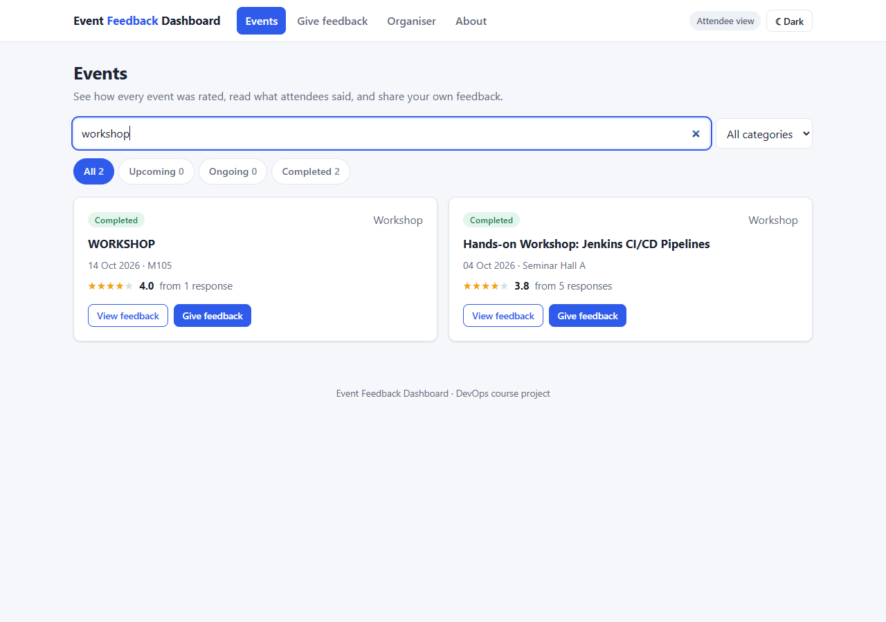
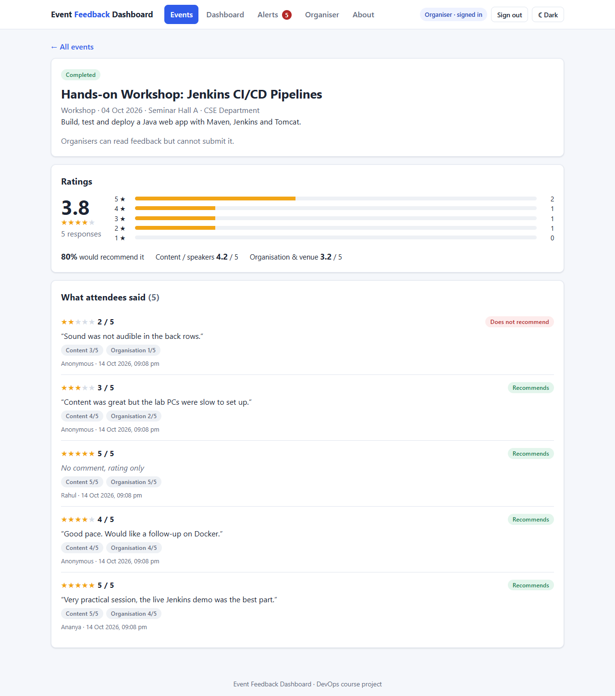
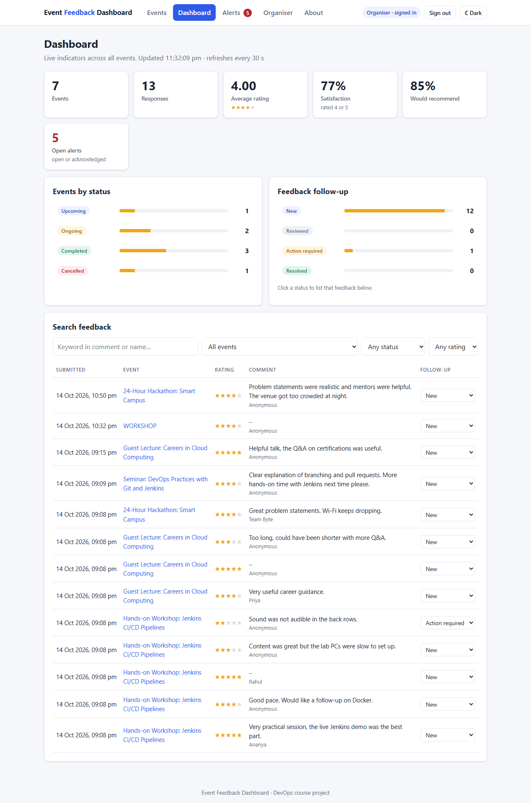
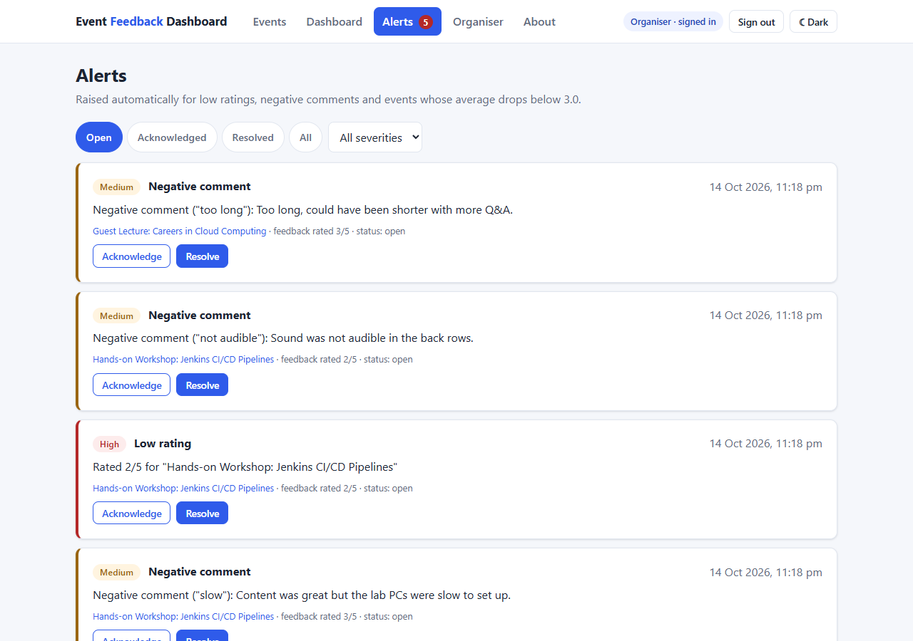
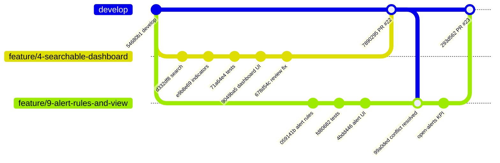
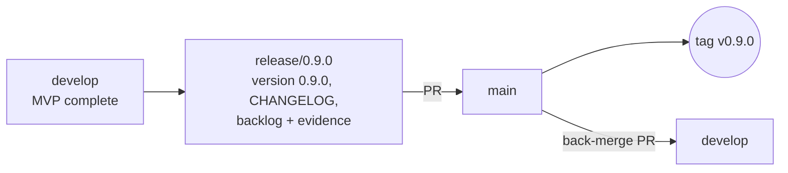

# Task 6 – MVP Completion and Git Collaboration

**Project:** Automated Event Feedback Dashboard · **Date:** 14-Oct-2026 · **Release:** v0.9.0

---

## 1. Functional MVP

All five MVP modules from the Task 1 scope are implemented, tested and merged into `develop`.

| Module | What the user gets | Main endpoints | Page | Issues / PR |
|--------|--------------------|----------------|------|-------------|
| **Data / event entry** | Organiser creates events and changes status; attendees rate ongoing/completed events | `POST /api/events`, `PATCH /api/events/{id}/status`, `POST /api/events/{id}/feedback` | `organiser.html`, `feedback.html` | #2, #3, #20 · PR #16, #21 |
| **Searchable dashboard** | Keyword/status/category/date search for events; feedback search for organisers | `GET /api/events?q=&status=&category=&from=&to=`, `GET /api/feedback?q=&eventId=&status=&minRating=&maxRating=` | `index.html`, `dashboard.html` | #4, #6 · PR #22 |
| **Summary indicators** | Events, responses, average rating, satisfaction %, recommend %, open alerts (auto-refresh 30 s) | `GET /api/dashboard/summary` | `dashboard.html` | #5, #6 · PR #22, #23 |
| **Status drill-down** | Status counts → event list → event page with distribution; feedback follow-up workflow | `GET /api/dashboard/status-breakdown`, `GET /api/events/{id}/summary`, `PATCH /api/feedback/{id}/status` | `dashboard.html`, `event.html` | #7, #8 · PR #22 |
| **Alert / exception view** | Automatic `LOW_RATING`, `NEGATIVE_COMMENT`, `LOW_AVERAGE` alerts; acknowledge / resolve; nav badge | `GET /api/alerts`, `GET /api/alerts/count`, `PATCH /api/alerts/{id}` | `alerts.html` | #9, #10 · PR #23 |

**Tests:** `mvn clean verify` → **45 tests, 0 failures** (search, indicators, drill-down, workflow, alert rules,
keyword matching, alert lifecycle, roles and CSRF).

| Searchable events (attendee) | Event drill-down |
|---|---|
|  |  |

| Organiser dashboard | Alert view |
|---|---|
|  |  |

## 2. Second feature branch – parallel development

Two feature branches were started from the **same** `develop` commit (`54680b1`) and developed in parallel,
as two team members would:



| Branch | Issues | Pull request | Merged as |
|--------|--------|--------------|-----------|
| `feature/4-searchable-dashboard` | #4 #5 #6 #7 #8 | [#22](https://github.com/vijayyh/event-feedback-dashboard/pull/22) | `7890295` |
| `feature/9-alert-rules-and-view` | #9 #10 | [#23](https://github.com/vijayyh/event-feedback-dashboard/pull/23) | `293d562` |

Both PRs were reviewed; the review comments (a search race condition on #22, the missing *open alerts*
indicator on #23) were fixed before merging.

## 3. Merge conflict – creation and resolution

After PR #22 was merged, GitHub reported PR #23 as **`mergeable: CONFLICTING`** – both branches had changed the
same lines in four files. The conflict was resolved locally by merging `develop` into the alerts branch:

```text
$ git merge origin/develop
Auto-merging README.md
CONFLICT (content): Merge conflict in README.md
Auto-merging src/main/java/com/eventfeedback/config/SecurityConfig.java
CONFLICT (content): Merge conflict in src/main/java/com/eventfeedback/config/SecurityConfig.java
Auto-merging src/main/java/com/eventfeedback/feedback/FeedbackService.java
Auto-merging src/main/resources/static/css/app.css
CONFLICT (content): Merge conflict in src/main/resources/static/css/app.css
Auto-merging src/main/resources/static/js/common.js
CONFLICT (content): Merge conflict in src/main/resources/static/js/common.js
Automatic merge failed; fix conflicts and then commit the result.
```

Conflict markers (two of the four files):

```text
=== src/main/resources/static/js/common.js
<<<<<<< HEAD
        ...(organiser ? [{ href: 'alerts.html', label: 'Alerts <span class="nav-badge" ...>', pages: ['alerts.html'] }] : []),
=======
        ...(organiser ? [{ href: 'dashboard.html', label: 'Dashboard', pages: ['dashboard.html'] }] : []),
>>>>>>> origin/develop

=== src/main/java/com/eventfeedback/config/SecurityConfig.java
<<<<<<< HEAD
                // alert/exception view
                .requestMatchers("/api/alerts/**", "/alerts.html").hasRole(ORGANISER)
=======
                // organiser dashboard: indicators, drill-down, feedback search and follow-up workflow
                .requestMatchers("/api/dashboard/**", "/dashboard.html").hasRole(ORGANISER)
                .requestMatchers(HttpMethod.GET, "/api/feedback").hasRole(ORGANISER)
                .requestMatchers(HttpMethod.PATCH, "/api/feedback/*/status").hasRole(ORGANISER)
>>>>>>> origin/develop
```

**Resolution:** neither side was wrong – each added its own feature at the same place – so **both sides were kept**
in all four files (dashboard first, then alerts): the organiser menu reads *Events · Dashboard · Alerts · Organiser ·
About*, all organiser endpoints stay protected, and both style blocks and README rows remain.
`FeedbackService.java` was changed by both branches in different places and merged automatically.

The full suite (**45 tests**) passed on the merged code before the merge commit
[`99a0ded`](https://github.com/vijayyh/event-feedback-dashboard/commit/99a0ded) was pushed; GitHub then reported
the PR as `MERGEABLE` and it was merged as `293d562`.

### Defect found after integration

Release screenshots showed that every event page failed with `renderEventHeader is not defined` – an edit in
PR #22 had removed the function. It was reported as [#24](https://github.com/vijayyh/event-feedback-dashboard/issues/24)
and fixed on `bugfix/24-event-page-header` ([PR #25](https://github.com/vijayyh/event-feedback-dashboard/pull/25)).
The API tests could not see it; the Selenium journeys of Task 9 cover this page.

## 4. Tagging and release-ready baseline



| Step | Evidence |
|------|----------|
| Release branch | `release/0.9.0` from `develop` |
| Version | `pom.xml` `0.1.0-SNAPSHOT` → **`0.9.0`** (shown by `/api/info` and the About page) |
| Release notes | [CHANGELOG.md](../CHANGELOG.md) |
| Quality gate | `mvn clean verify` – 45 tests green, `event-feedback-dashboard.war` built |
| Merge to `main` | pull request `release/0.9.0` → `main` |
| Tag | annotated tag **`v0.9.0`** on the `main` merge commit (`git tag -a v0.9.0 -m "..."`, `git push origin v0.9.0`) |
| GitHub release | [v0.9.0](https://github.com/vijayyh/event-feedback-dashboard/releases/tag/v0.9.0) with notes and the WAR attached |
| Back-merge | `main` → `develop`, so the release commit is part of further development |

`v0.9.0` is the **release-ready source baseline**: every later CI/CD task (Jenkins job, pipeline, Tomcat deployment,
Selenium) builds on exactly this tagged source.

## 5. Updated backlog

- Issues #1–#10, #17, #20 and #24 are **closed**; acceptance criteria ticked on GitHub.
- Board snapshot and velocity: [docs/02 – Board at release v0.9.0](02-agile-planning-and-devops-workflow.md#board-at-release-v090-14-oct-2026-task-6).
- Remaining: T11 tests/coverage, T12 Jenkins CI, T13 Tomcat deployment, T14 monitoring, T15 release v1.0.

## 6. Deliverables checklist

| Deliverable | Evidence |
|-------------|----------|
| Functional MVP | Section 1 – five modules, 45 tests, screenshots |
| Resolved merge conflict | Section 3 – conflict output and markers, merge commit `99a0ded`, PR #23 |
| Tagged version | Section 4 – tag `v0.9.0` and GitHub release |
| Updated backlog | Section 5 and docs/02 |
