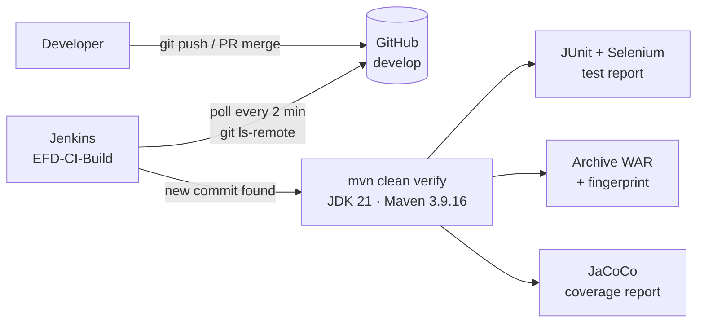
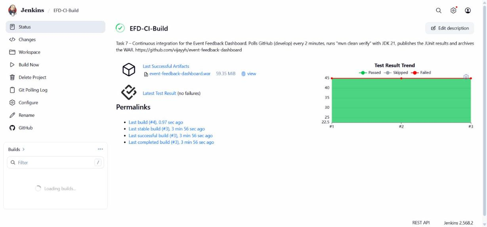
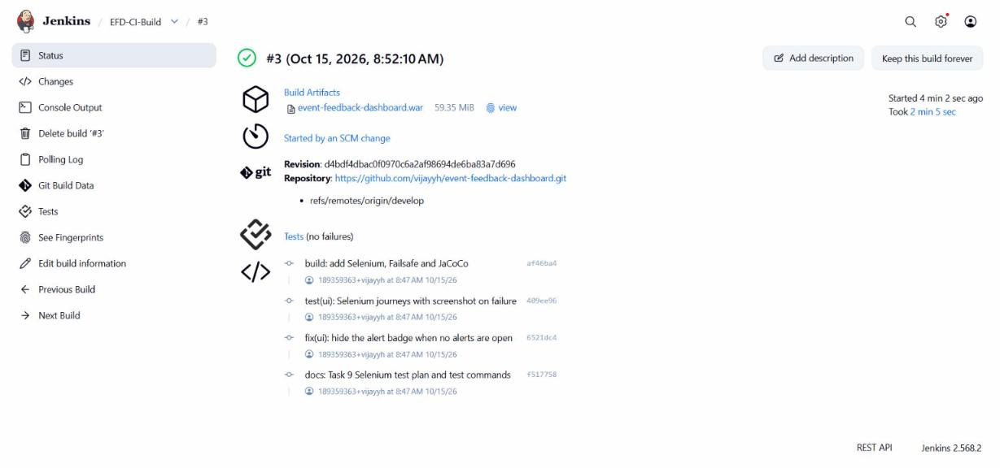
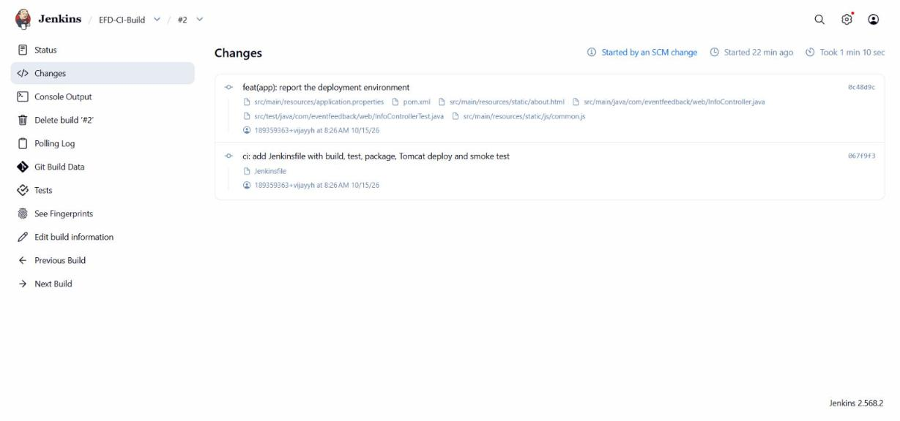

# Task 7 – Continuous Integration with Jenkins

**Project:** Automated Event Feedback Dashboard · **Date:** 15-Oct-2026 · **Jenkins:** 2.568.2 (Windows service, http://localhost:8080)

---

## 1. Goal

Every commit that reaches `develop` is built and tested automatically, with no manual step. The tested WAR is
stored in Jenkins so that later stages (Task 8 deployment) and testers always use a build Jenkins produced, not a
file from a developer's laptop.



## 2. Jenkins set-up

| Item | Configuration |
|------|---------------|
| Tools (*Manage Jenkins → Tools*) | JDK **`JDK-21`** → `C:\DevTools\jdk-21`; Maven **`Maven-3.9.16`** (installed automatically by Jenkins) |
| Plugins used | Git, GitHub, Pipeline, JUnit, Credentials Binding, Timestamper, Pipeline Graph View |
| Agent | Built-in node, 2 executors, Windows (`bat` / `powershell` steps) |
| Browser for UI tests | Google Chrome, run headless by Selenium under the Jenkins service account |

## 3. The CI job `EFD-CI-Build`

A **freestyle job**, kept deliberately simple so that every setting is visible in the UI.

| Section | Setting |
|---------|---------|
| Description | Continuous integration for the Event Feedback Dashboard |
| GitHub project | `https://github.com/vijayyh/event-feedback-dashboard/` |
| Source code management | Git · `https://github.com/vijayyh/event-feedback-dashboard.git` · branch **`*/develop`** (public repository, so no credentials are needed) |
| Build trigger | **Poll SCM** · schedule `H/2 * * * *` (every 2 minutes; `H` spreads jobs so they do not all poll at the same second) |
| Build step | *Invoke top-level Maven targets* · Maven `Maven-3.9.16` · goals **`-B -ntp clean verify`** |
| Post-build: test report | *Publish JUnit test result report* · `target/surefire-reports/*.xml, target/failsafe-reports/*.xml` |
| Post-build: artefacts | *Archive the artifacts* · `target/*.war, target/selenium-screenshots/**, target/site/jacoco/**` · **fingerprint** on |
| Housekeeping | Discard old builds, keep the last 20 |

**Why polling rather than a GitHub webhook?** Jenkins runs on `localhost`, so GitHub cannot reach it to deliver a
webhook. Polling reverses the direction: Jenkins asks GitHub (`git ls-remote`) whether `develop` has a new
commit. With a public Jenkins URL, the same job would use the *GitHub hook trigger* instead.

`mvn clean verify` runs the whole quality gate in one command:

1. Compiles the code.
2. Runs the unit and API tests with Surefire (45 at first, 51 since bug fix #32).
3. Packages `event-feedback-dashboard.war`.
4. Starts the application and drives Chrome through the 9 Selenium journeys (Failsafe).
5. Fails the build if service-layer line coverage drops below 70 % (JaCoCo check).



## 4. Evidence – builds triggered by commits

All nine builds of the job were started by SCM polling. None was started by hand.

| Build | Started by | Commits picked up | Result | Duration |
|-------|-----------|-------------------|--------|----------|
| #1 | SCM change | first poll – current `develop` | ✅ SUCCESS | 2 min 21 s |
| #2 | SCM change | `0c48d9c` feat(app): report the deployment environment · `067f9f3` ci: add Jenkinsfile | ✅ SUCCESS | 1 min 11 s |
| #3 | SCM change | `af46ba4` build: Selenium, Failsafe, JaCoCo · `409ee96` test(ui): Selenium journeys · `6521dc4` fix(ui): alert badge · `f517758` docs: Task 9 | ✅ SUCCESS | 2 min 5 s |
| #4 | SCM change | `2c818d0` ci: run Selenium journeys in the pipeline | ✅ SUCCESS | 1 min 59 s |
| #5 | SCM change | `eac1c09` ci: deploy to a pipeline-managed Tomcat 11 instance (PR #31) | ✅ SUCCESS | 3 min 33 s |
| #6 | SCM change | PR #33 – fix #32, every response as UTF-8 (+6 tests) | ✅ SUCCESS | 2 min 26 s |
| #7 | SCM change | PR #35 – fix #34, single redeploy | ✅ SUCCESS | 2 min 30 s |
| #8 | SCM change | PR #36 – **deliberate Task 10 defect** | ❌ **FAILURE** – Selenium UJ-02 | 2 min 51 s |
| #9 | SCM change | PR #38 – fix #37 | ✅ SUCCESS | 2 min 31 s |

Build #8 shows the CI job doing its job: the commit compiled and passed all 51 API tests, but the browser journey
failed, so the build went red within 3 minutes of the merge (details in [docs/10](10-continuous-testing-in-jenkins.md)).

Polling log of build #3 shows how a commit is detected:

```text
Started on 15-Oct-2026, 8:52:00 am
[poll] Last Built Revision: Revision 127b1bb6daa82d1552faee59e517afc5e48b854f (refs/remotes/origin/develop)
 > git.exe ls-remote -h -- https://github.com/vijayyh/event-feedback-dashboard.git # timeout=10
[poll] Latest remote head revision on refs/heads/develop is: d4bdf4dbac0f0970c6a2af98694de6ba83a7d696
Done. Took 0.9 sec
Changes found
```

…and a poll with nothing new does not start a build:

```text
[poll] Latest remote head revision on refs/heads/develop is: e5e1fd5db24a2bf2feedd55070e2c117cf629474 - already built by 5
No changes
```

| Build #3 – started by an SCM change, WAR archived | Build #2 – the commits that triggered it |
|---|---|
|  |  |

Console of build #5 (shortened):

```text
Started by an SCM change
Checking out Revision e5e1fd5db24a2bf2feedd55070e2c117cf629474 (refs/remotes/origin/develop)
[EFD-CI-Build] $ cmd.exe /C "...\Maven-3.9.16\bin\mvn.cmd -B -ntp clean verify"
[INFO] Tests run: 45, Failures: 0, Errors: 0, Skipped: 0
[INFO] Tests run: 9, Failures: 0, Errors: 0, Skipped: 0
[INFO] All coverage checks have been met.
[INFO] BUILD SUCCESS
Recording test results
Archiving artifacts
Recording fingerprints
Finished: SUCCESS
```

## 5. Archived artefact

| Artefact | Where | Purpose |
|----------|-------|---------|
| `event-feedback-dashboard.war` (59.35 MiB) | *Build → Build Artifacts* and *Last Successful Artifacts* on the job page | the deployable build; its **fingerprint** (MD5) lets Jenkins trace which build produced a WAR found on a server |
| `target/site/jacoco/**` | Build Artifacts | HTML coverage report |
| `target/selenium-screenshots/**` | Build Artifacts (only when a UI test fails) | screenshot and page HTML at the moment of failure |

Stable download URL of the newest tested WAR:
`http://localhost:8080/job/EFD-CI-Build/lastSuccessfulBuild/artifact/target/event-feedback-dashboard.war`

## 6. Deliverables checklist

| Deliverable | Evidence |
|-------------|----------|
| Jenkins job configuration | Section 3 and the job page screenshot |
| GitHub repository connected | Git SCM `https://github.com/vijayyh/event-feedback-dashboard.git`, branch `develop`; GitHub project link |
| Build triggered by commit / polling | Section 4 – nine builds "Started by an SCM change", polling log |
| Maven build | `mvn -B -ntp clean verify` – compile, 60 tests (51 unit/API + 9 Selenium), WAR, coverage gate |
| Archived artefact | Section 5 – WAR with fingerprint, coverage report |
