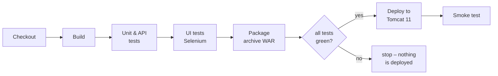
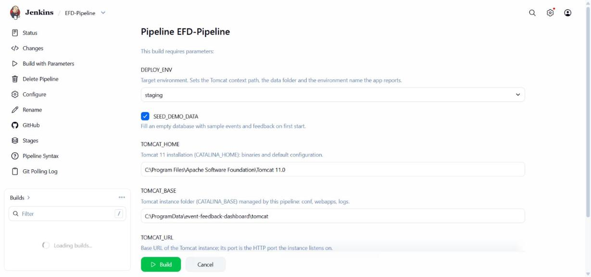
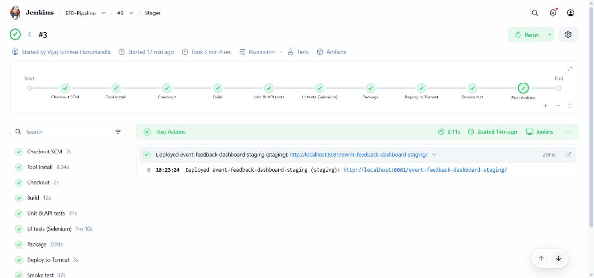
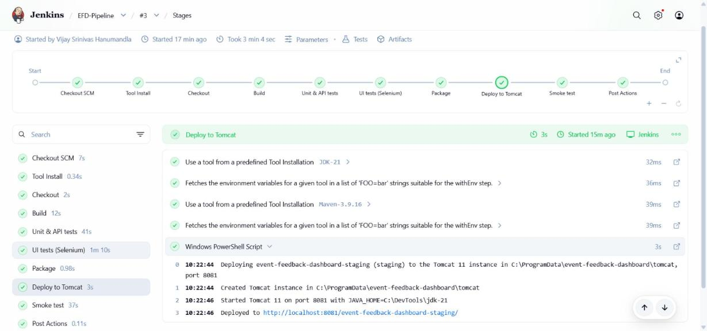
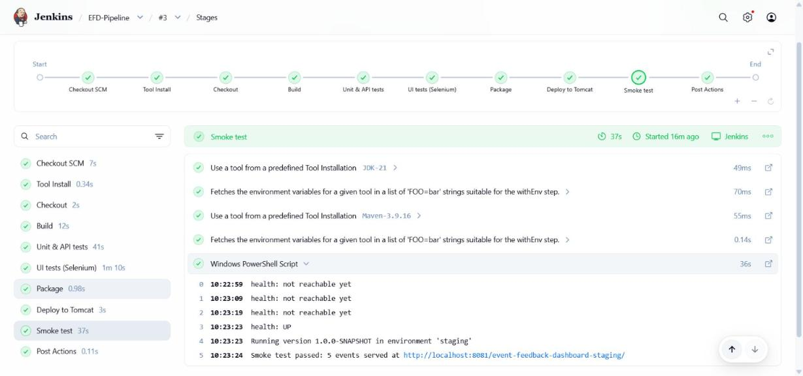
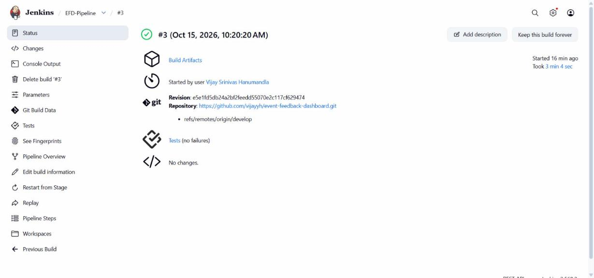
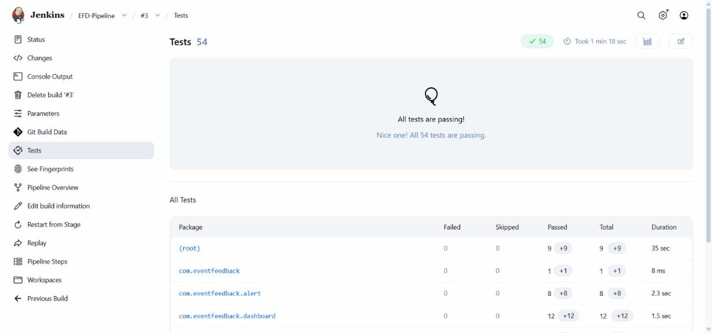
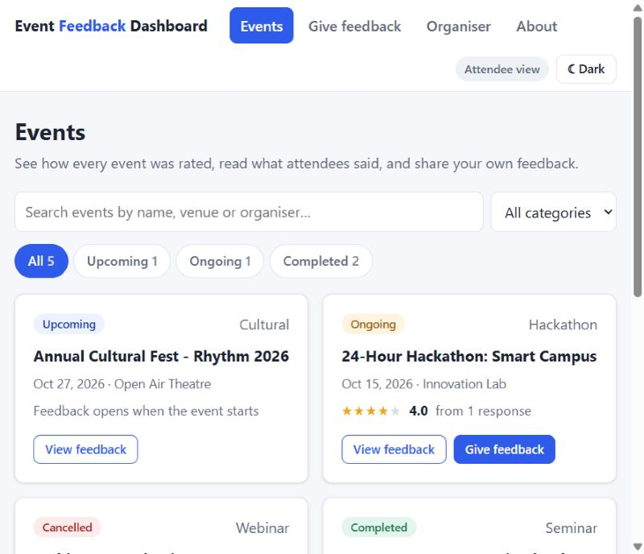
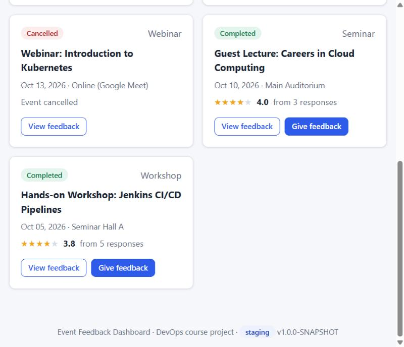
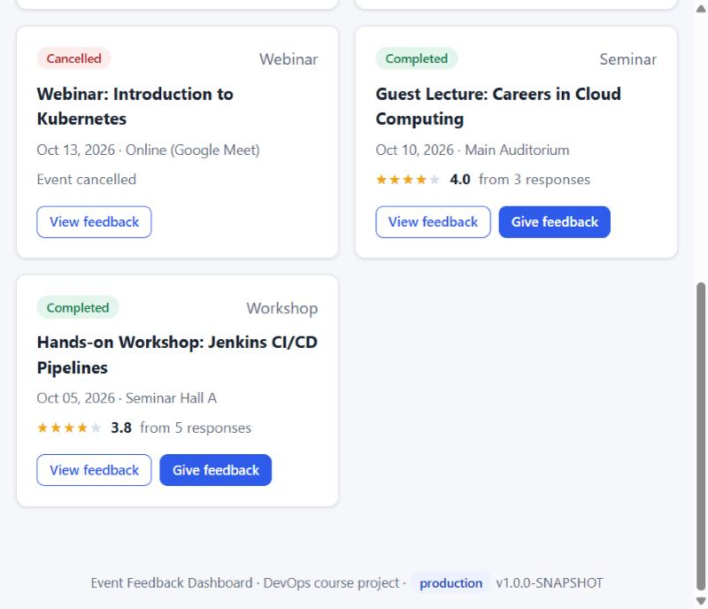

# Task 8 – Pipeline as Code and Deployment to Tomcat

**Project:** Automated Event Feedback Dashboard · **Date:** 15-Oct-2026 · **Jenkins job:** `EFD-Pipeline` · **Server:** Apache Tomcat 11.0 on JDK 21

---

## 1. Goal

The whole delivery process is described in one versioned file, the [`Jenkinsfile`](../Jenkinsfile). Every
commit on `develop` goes through the same checked steps, from source code to a running application on Tomcat.
Each change to the process itself is reviewed in a pull request like any other code.



## 2. The Jenkinsfile

Declarative pipeline, stored in the repository root. Its main blocks:

| Block | Content | Why |
|-------|---------|-----|
| `agent any` | built-in Windows node | `bat` / `powershell` steps |
| `tools` | `jdk 'JDK-21'`, `maven 'Maven-3.9.16'` | the same tool versions on every run |
| `parameters` | `DEPLOY_ENV`, `SEED_DEMO_DATA`, `TOMCAT_HOME`, `TOMCAT_BASE`, `TOMCAT_URL` | environment settings chosen per run (section 4) |
| `environment` | `APP_CONTEXT` derived from `DEPLOY_ENV` | `/event-feedback-dashboard` (production) or `/event-feedback-dashboard-staging` |
| `options` | keep 20 builds, no concurrent builds, timestamps, 30 min timeout | two deployments never run at the same time |
| `triggers` | `pollSCM('H/2 * * * *')` | a commit on `develop` starts the pipeline (see Task 7 for why it polls) |
| `post` | success / failure / unstable messages | the run ends with the deployed URL or the reason nothing was deployed |

| Stage | Step | Result |
|-------|------|--------|
| **Checkout** | `checkout scm` + `git log -1` | exact commit being delivered |
| **Build** | `mvn -B -ntp clean compile` | compiles with JDK 21 |
| **Unit & API tests** | `mvn -B -ntp test` + `junit 'target/surefire-reports/*.xml'` | 51 tests published in Jenkins (45 before bug #32 added 6) |
| **UI tests (Selenium)** | `mvn -B -ntp verify -DskipUTs=true` + `junit 'target/failsafe-reports/*.xml'` | 9 browser journeys, WAR, coverage gate; screenshots archived on failure |
| **Package** | `archiveArtifacts 'target/*.war'` (fingerprinted) and the JaCoCo report | the artefact that gets deployed |
| **Deploy to Tomcat** | PowerShell, `when { currentBuild.resultIsBetterOrEqualTo('SUCCESS') }` | WAR and context settings copied to the Tomcat instance |
| **Smoke test** | PowerShell: `/actuator/health` until `UP`, `/api/info` environment, `/api/events`, home page charset | proves the deployed app works, not just that a file was copied |

## 3. Jenkins job `EFD-Pipeline`

| Setting | Value |
|---------|-------|
| Type | Pipeline |
| Definition | **Pipeline script from SCM** · Git `https://github.com/vijayyh/event-feedback-dashboard.git` · branch `*/develop` · script path `Jenkinsfile` · lightweight checkout |
| Trigger, parameters, options | come from the Jenkinsfile. Jenkins registers them after the first run, which is why "Build with Parameters" then appears |
| Secret | Credentials → *Secret text* **`efd-organiser-password`**: the organiser password of the deployed app. It is bound with `withCredentials` only inside the deploy stage, is masked in the log, and never appears in Git |

## 4. Parameterised environment settings



| Parameter | Type / default | What it changes |
|-----------|----------------|-----------------|
| **`DEPLOY_ENV`** | choice `staging` / `production` | context path (`/event-feedback-dashboard-staging` or `/event-feedback-dashboard`), the environment name the app reports, and a separate database folder per environment |
| `SEED_DEMO_DATA` | boolean, `true` | fills an empty database with sample events |
| `TOMCAT_HOME` | `C:\Program Files\Apache Software Foundation\Tomcat 11.0` | Tomcat installation (CATALINA_HOME) |
| `TOMCAT_BASE` | `C:\ProgramData\event-feedback-dashboard\tomcat` | Tomcat instance folder (CATALINA_BASE) managed by the pipeline |
| `TOMCAT_URL` | `http://localhost:8081` | base URL; its port becomes the instance's HTTP port |

The settings reach the application without rebuilding the WAR. The deploy stage writes a Tomcat **context
descriptor**. Tomcat hands each `<Parameter>` to the app as a servlet context parameter, and Spring Boot reads
those like entries in `application.properties`. Generated file for staging (password masked here):

```xml
<!-- C:\ProgramData\event-feedback-dashboard\tomcat\conf\Catalina\localhost\event-feedback-dashboard-staging.xml -->
<!-- Written by the Jenkins pipeline EFD-Pipeline - do not edit by hand -->
<Context>
    <Parameter name="app.environment" value="staging" override="false"/>
    <Parameter name="app.seed-demo-data" value="true" override="false"/>
    <Parameter name="app.data-dir" value="${user.home}/.event-feedback-dashboard/staging" override="false"/>
    <Parameter name="spring.security.user.password" value="********" override="false"/>
</Context>
```

The production run writes `event-feedback-dashboard.xml` with `production` and its own data folder.

The application shows the value in the page footer and returns it from `GET /api/info`. The smoke test fails
when it differs from `DEPLOY_ENV`.

## 5. How the deployment works

The Tomcat 11 Windows service on this PC is configured to run on Java 8, and Tomcat 11 needs Java 17 or newer.
Changing a Windows service is a system change, so the pipeline leaves the service alone and runs its **own
Tomcat instance** instead. It uses the binaries of the installed Tomcat 11 (CATALINA_HOME) with its own
configuration folder (CATALINA_BASE) on JDK 21:

1. **First run only:** create `conf`, `logs`, `temp`, `webapps`, `work` in `TOMCAT_BASE`. Copy the default
   configuration and set the HTTP port from `TOMCAT_URL` (`8081`; Jenkins already uses 8080).
2. Write the context descriptor with the environment settings (section 4), but only when a setting changed.
   Tomcat redeploys the app whenever this file changes (see §7.3).
3. Copy `target\event-feedback-dashboard.war` to `webapps\<context>.war`. Tomcat's auto-deploy picks it up, and on
   later runs it redeploys the new version in place.
4. If nothing listens on the port, start Tomcat with `catalina.bat start`. `JENKINS_NODE_COOKIE=dontKillMe`
   stops Jenkins from killing the server when the build ends.

Then the **smoke test** polls the health endpoint for up to 3 minutes and checks three things:
- the reported environment matches `DEPLOY_ENV`;
- the API returns the events;
- the home page is served as UTF-8 (added after bug #32, section 7).

## 6. Evidence – successful run (build #3)

Started with **DEPLOY_ENV = staging** on commit `e5e1fd5` (merge of PR #31). Result: **SUCCESS** in 3 min 4 s.



| Stage | Time | Output (shortened) |
|-------|------|--------------------|
| Checkout | 2 s | `e5e1fd5 Merge pull request #31 from vijayyh/feature/13-tomcat-instance-deploy (vijayyh)` |
| Build | 12 s | `BUILD SUCCESS` |
| Unit & API tests | 41 s | `Tests run: 45, Failures: 0, Errors: 0, Skipped: 0` |
| UI tests (Selenium) | 1 min 10 s | `UJ-01 … UJ-05` – `Tests run: 9, Failures: 0` |
| Package | 1 s | WAR archived and fingerprinted |
| Deploy to Tomcat | 3 s | see below |
| Smoke test | 37 s | see below |

```text
Deploying event-feedback-dashboard-staging (staging) to the Tomcat 11 instance in C:\ProgramData\event-feedback-dashboard\tomcat, port 8081
Created Tomcat instance in C:\ProgramData\event-feedback-dashboard\tomcat
Started Tomcat 11 on port 8081 with JAVA_HOME=C:\DevTools\jdk-21
Deployed to http://localhost:8081/event-feedback-dashboard-staging/
health: not reachable yet
health: UP
Running version 1.0.0-SNAPSHOT in environment 'staging'
Smoke test passed: 5 events served at http://localhost:8081/event-feedback-dashboard-staging/
Deployed event-feedback-dashboard-staging (staging): http://localhost:8081/event-feedback-dashboard-staging/
Finished: SUCCESS
```

| Deploy stage | Smoke test stage |
|---|---|
|  |  |

| Build summary | Published test report – 54 tests |
|---|---|
|  |  |

**Deployed URL:** http://localhost:8081/event-feedback-dashboard-staging/

## 7. Problems found while setting up the pipeline

### 7.1 Builds #1 and #2 "succeeded" without running a stage

The first two runs ended **SUCCESS in a few seconds**. Only *Declarative: Post Actions* ran, and the post block
printed `Deployed null (staging)`. Jenkins logged no error. A throw-away diagnostics job narrowed it down:

| Test script | Result |
|-------------|--------|
| `pipeline { agent any … }` | stage skipped, no `[Pipeline] node` line |
| `node { echo … }` (scripted) | body silently skipped |
| `pipeline { agent none … }` + `echo` | works |
| `bat 'echo hi'` | `NoSuchMethodError: No such DSL method 'bat' found among steps [...]` |

`node`, `bat`, `powershell` and `dir` were missing from the step list, although the plugins showed as installed
and active. Every plugin jar was checked: two extracted jars,
`plugins\workflow-durable-task-step\WEB-INF\lib\workflow-durable-task-step.jar` and `plugins\durable-task\…\durable-task.jar`,
were **corrupt** (169 409 of 169 847 bytes were zero, probably after an unclean shutdown). The `.jpi` packages
were intact.

**Fix:**
1. Re-deployed the same plugin versions with *Manage Jenkins → Plugins → Advanced settings → Deploy Plugin*.
2. Restarted Jenkins. Jenkins re-extracted both plugins and the jars became valid again (158 and 68 entries).

The diagnostics job was deleted afterwards. **Lesson:** a green build that took 4 seconds is a red flag. Test
counts and stage logs must be checked, not only the result colour.

### 7.2 Bug #32 – garbled characters on Tomcat

The first deployment showed `·` instead of `·`, `…` instead of `…`, and broken rating stars:


The embedded server used during development never showed this. Tomcat served the home page as
`text/html;charset=ISO-8859-1`: Spring calls `setLocale(en)` when it renders the welcome page, and a standard
Tomcat maps `en` to ISO-8859-1.

- **Issue:** [#32](https://github.com/vijayyh/event-feedback-dashboard/issues/32)
- **Branch:** `bugfix/32-utf8-responses` · **PR:** [#33](https://github.com/vijayyh/event-feedback-dashboard/pull/33)

| Change | Purpose |
|--------|---------|
| `server.servlet.encoding.force-response=true` (+ `charset=UTF-8`) | every response states UTF-8, on any container |
| `Utf8ResponsesTest` (6 cases) | regression test: pages, scripts, styles and API declare UTF-8. It failed before the fix and passes after |
| Smoke test checks the home page `Content-Type` | catches this class of bug on the real server, where it happens |

Run against the deployment from build #3, the new smoke check fails as intended:
`Home page is not served as UTF-8 (text/html;charset=ISO-8859-1)`.

### 7.3 Bug #34 – every deployment restarted the app twice

Right after build #4 the staging URL briefly returned **404**, although the smoke test had passed. The Tomcat log
showed two restarts per deployment:

```text
11:13:52 HostConfig.reload    Reloading context [/event-feedback-dashboard-staging]     <- new WAR
11:14:40 StandardContext      Reloading Context ... is completed                         <- smoke test passed here
11:14:50 HostConfig.undeploy  Undeploying context [/event-feedback-dashboard-staging]     <- context file changed
11:15:06 HostConfig           Deployment of deployment descriptor ... has finished       <- 404 in between
```

The generated context file contained the build number, so it changed on every run, and Tomcat redeploys whenever
it changes. **Fix** ([#34](https://github.com/vijayyh/event-feedback-dashboard/issues/34),
[PR #35](https://github.com/vijayyh/event-feedback-dashboard/pull/35)):
- The file no longer contains the build number.
- It is only rewritten when a setting changes. The log then says `Context settings unchanged`.

Since build #8 a routine deployment reloads the app exactly once (`12:18:04 reload … 12:18:44 completed`, nothing after).

## 8. After the fixes – redeploy and a second environment

**Build #4** started by itself 2 minutes after PR #33 was merged ("Started by an SCM change"). It ran 51 + 9 tests,
hot-redeployed staging, and the new smoke check passed:

```text
Tomcat is already running on port 8081 - the new WAR is redeployed automatically
health: UP
Running version 1.0.0-SNAPSHOT in environment 'staging'
Home page Content-Type: text/html;charset=UTF-8
Smoke test passed: 5 events served at http://localhost:8081/event-feedback-dashboard-staging/
```



**Build #5** was started with *Build with Parameters → `DEPLOY_ENV = production`*. The **same pipeline and the
same tested code** now run in a second environment, next to staging, with its own context path, database folder and
environment name:

```text
Deploying event-feedback-dashboard (production) to the Tomcat 11 instance in C:\ProgramData\event-feedback-dashboard\tomcat, port 8081
Running version 1.0.0-SNAPSHOT in environment 'production'
Smoke test passed: 5 events served at http://localhost:8081/event-feedback-dashboard/
```

| URL | `GET /api/info` → environment |
|-----|-------------------------------|
| http://localhost:8081/event-feedback-dashboard-staging/ | `staging` |
| http://localhost:8081/event-feedback-dashboard/ | `production` |

| Staging footer | Production footer |
|---|---|
|  |  |

## 9. Deliverables checklist

| Deliverable | Evidence |
|-------------|----------|
| Jenkinsfile | [`Jenkinsfile`](../Jenkinsfile) – section 2 |
| Successful pipeline run | Section 6 – build #3: all 9 stages green |
| Deployed URL / screenshot | staging http://localhost:8081/event-feedback-dashboard-staging/ and production http://localhost:8081/event-feedback-dashboard/ – sections 6 and 8 |
| Configuration evidence | Sections 3–5 – job definition, parameters, context descriptor, Tomcat instance |
| At least one parameterised environment setting | `DEPLOY_ENV` (+ 4 more) – section 4, used for staging (#3, #4) and production (#5) |
