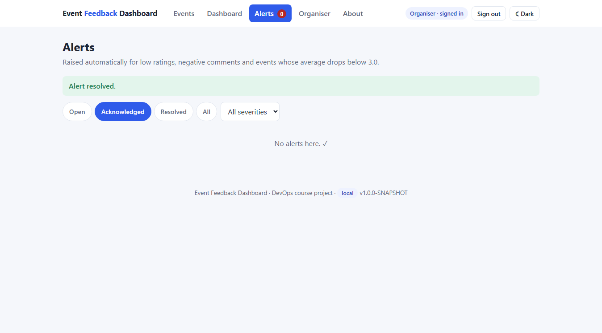

# Task 9 – Selenium Test Design and Local Execution

**Project:** Automated Event Feedback Dashboard · **Date:** 15-Oct-2026

---

## 1. Test plan

| Item | Decision |
|------|----------|
| Objective | Prove that the five most important user journeys work end-to-end in a real browser, and stop a release when one breaks. |
| Scope | Browser UI + REST API + database, exercised together. Business rules are also covered by 45 API tests (`*Test.java`). |
| Tool | Selenium WebDriver 4.31 (Java), JUnit 5, AssertJ |
| Browser | Google Chrome, headless by default (`--headless=new`, 1366×900); driver resolved automatically by Selenium Manager |
| System under test | The real application started by Spring Boot on a **random free port** (`@SpringBootTest(webEnvironment = RANDOM_PORT)`) with the in-memory H2 test database |
| Test data | Created per test through the repositories/services (events with a given status, feedback that triggers the alert rules); all data deleted after each test, so tests are independent and can run in any order |
| Credentials | Organiser password of the `test` profile only (`application-test.properties`); never a real password |
| Runner | Maven **Failsafe** (`*UiIT.java`) in the `integration-test` phase of `mvn verify`; unit/API tests stay in Surefire (`*Test.java`) |
| Failure evidence | JUnit 5 extension `ScreenshotOnFailure` saves a **PNG screenshot and the page HTML** to `target/selenium-screenshots/` the moment a test fails (before the browser is closed) |
| Reports | `target/failsafe-reports/*.xml` (JUnit XML, read by Jenkins) and HTML reports `target/reports/failsafe.html` / `surefire.html`; coverage `target/site/jacoco/index.html` |
| Exit criteria | All journeys green, no open defect of severity major or higher, service-layer line coverage ≥ 70 % (enforced by the JaCoCo check) |

## 2. Critical user journeys

| ID | Journey | Test class / test | Key steps | Assertions |
|----|---------|-------------------|-----------|------------|
| **UJ-01** | Attendee browses and searches events | `BrowseEventsUiIT` – *status tabs show only the events with that status*, *keyword search narrows the list* | Open Events page → click **Completed** → click **Upcoming** → type "hack" in search | Tab counts; only matching cards shown; upcoming event says "Feedback opens when the event starts" and has no Give-feedback button |
| **UJ-02** | Attendee gives feedback and sees it on the event page | `SubmitFeedbackUiIT` – *submits feedback and sees it on the event page*, *missing ratings are reported*, *upcoming event cannot be rated* | Rate 4/5/4, Yes, comment, name → Submit → **See all feedback** | Thank-you panel; event page header (regression test for bug #24), score 4.0, "1 response", "100% would recommend", comment and name shown; empty form gives field errors and stores nothing; upcoming event blocked |
| **UJ-03** | Organiser signs in, creates an event and opens it for feedback | `OrganiserManagesEventsUiIT` – *attendee is sent to sign-in and a wrong password is rejected*, *creates an event and opens it for feedback* | Open organiser page as attendee → wrong password → sign in → create event → set **Ongoing** → sign out | Redirect to sign-in; error message; "saved" and "is now ongoing" notices; attendee view shows the event with **Give feedback** |
| **UJ-04** | Organiser reads indicators and drills down | `DashboardUiIT` – *shows the indicators and drills down* | Sign in → Dashboard → click **Completed** → open the event | KPI cards: 2 events, 3 responses, 3.67 average, 67 % satisfaction, 2 open alerts; drill-down lists the completed event; event page score 4.5 |
| **UJ-05** | A bad review raises alerts; organiser works them off | `AlertHandlingUiIT` – *a low rating raises alerts that the organiser acknowledges and resolves* | Rating 1 with "worst … not audible" → sign in → badge **2** → Alerts → Acknowledge → Resolve → Resolve acknowledged | Two alerts (low rating, negative comment); badge stays 2 after acknowledge; "No alerts here"; badge disappears; all alerts RESOLVED in the database |

## 3. How to run

```bash
mvn verify                                   # unit/API tests + Selenium journeys + coverage check
mvn verify -DskipUTs=true                    # only the Selenium journeys
mvn verify -Dselenium.headless=false         # watch the tests drive a visible Chrome window
mvn surefire-report:report-only surefire-report:failsafe-report-only   # HTML reports in target/reports/
```

Prerequisites: JDK 21, Maven 3.9, Google Chrome. No server has to be started – each test run starts the
application itself on a free port.

## 4. Local results (15-Oct-2026)

```text
[INFO] Tests run: 45, Failures: 0, Errors: 0, Skipped: 0      <- Surefire: unit and API tests
[INFO] Tests run: 9, Failures: 0, Errors: 0, Skipped: 0       <- Failsafe: Selenium journeys
       UJ-01 Browse and search events ............. 2 passed
       UJ-02 Give feedback ........................ 3 passed
       UJ-03 Organiser manages events ............. 2 passed
       UJ-04 Dashboard indicators and drill-down .. 1 passed
       UJ-05 Alert handling ....................... 1 passed
[INFO] All coverage checks have been met.                     <- service-layer line coverage 97.3 %, total 88.7 %
[INFO] BUILD SUCCESS
```

## 5. Failure screenshot mechanism – a real catch

On the first run, **UJ-05 failed**: after every alert was resolved the navigation badge still showed a red
**"0"**. The extension captured the page at the moment of failure:

```text
[selenium] Test failed on http://localhost:53064/alerts.html
[selenium] Screenshot: target\selenium-screenshots\AlertHandlingUiIT_lowRatingRaisesAlertsThatTheOrganiserResolves_20261015-084122.png
[selenium] Page HTML:  target\selenium-screenshots\AlertHandlingUiIT_lowRatingRaisesAlertsThatTheOrganiserResolves_20261015-084122.html
org.openqa.selenium.TimeoutException: waiting for element to no longer be visible: By.id: alertBadge
```



**Cause:** the badge is hidden with the HTML `hidden` attribute, but its CSS rule `display: inline-block`
overrides that attribute. **Fix:** `.nav-badge[hidden] { display: none; }` – after the fix all 9 journeys pass.
This defect was invisible to the API tests, as was bug #24 (event page header) which UJ-02 now guards against.

## 6. Deliverables checklist

| Deliverable | Evidence |
|-------------|----------|
| Test plan | Sections 1–2 |
| Selenium scripts | `src/test/java/com/eventfeedback/ui/` – `UiTestBase`, `ScreenshotOnFailure` and five `*UiIT` journey classes |
| Local test report | Section 4; `target/failsafe-reports`, `target/reports/failsafe.html` |
| Failure screenshot mechanism | `ScreenshotOnFailure` + section 5 |
