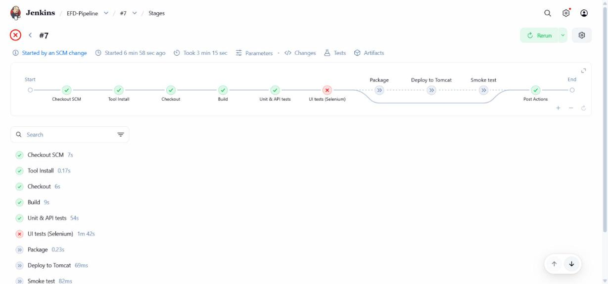
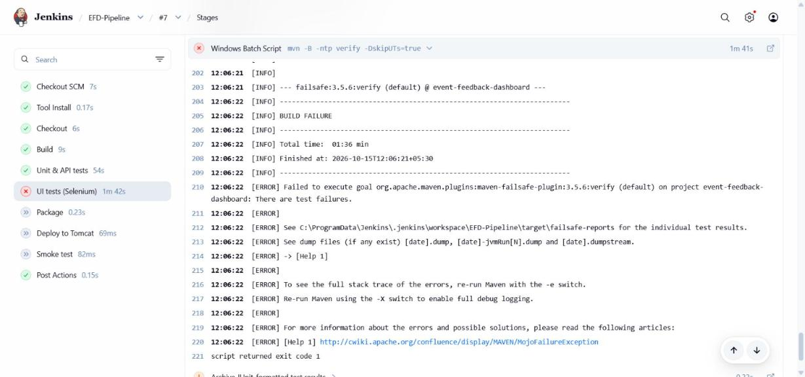
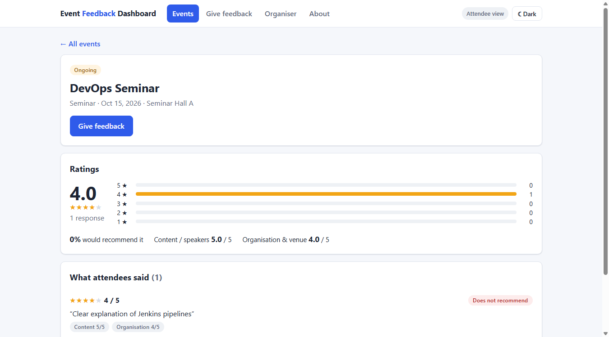
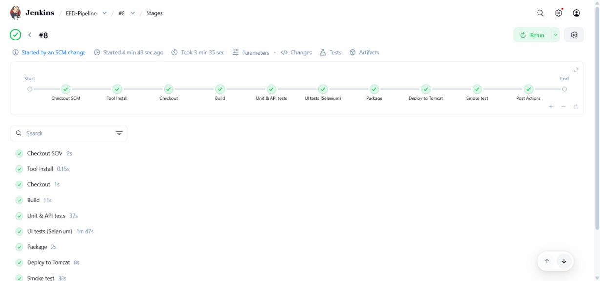

# Task 10 – Continuous Testing in Jenkins

**Project:** Automated Event Feedback Dashboard · **Date:** 15-Oct-2026 · **Jenkins job:** `EFD-Pipeline`

---

## 1. Goal

Every commit runs the full automated test suite in Jenkins: 51 unit/API tests and 9 Selenium browser journeys.
The results are published in Jenkins, and **a single failing test stops the release before deployment**. To prove
this, a defect was introduced on purpose, caught by the pipeline, fixed through the normal bug process, and the
pipeline was run again.

## 2. How the pipeline tests

| Stage | Command | Published in Jenkins |
|-------|---------|----------------------|
| Unit & API tests | `mvn -B -ntp test` | `junit 'target/surefire-reports/*.xml'` → *Tests* tab, trend chart |
| UI tests (Selenium) | `mvn -B -ntp verify -DskipUTs=true`: starts the app on a free port and drives headless Chrome through journeys UJ-01 … UJ-05 (see [docs/09](09-selenium-test-plan.md)) | `junit 'target/failsafe-reports/*.xml'` and `archiveArtifacts 'target/selenium-screenshots/**'` in `post { always { … } }`, so they are published **even when the stage fails** |
| Package | archive the WAR and the JaCoCo coverage report | *Artifacts* |
| Deploy to Tomcat | `when { expression { currentBuild.resultIsBetterOrEqualTo('SUCCESS') } }` | – |
| Smoke test | health, environment, events API and home page charset on the deployed server | console log |

**Two gates stop a deployment:**
1. A failing test makes Maven return a non-zero exit code. The stage fails, and Declarative Pipeline skips every
   later stage ("skipped due to earlier failure(s)").
2. The `when` condition on *Deploy* and *Smoke test* also requires the build result to still be SUCCESS. A build
   marked UNSTABLE by test results is therefore never deployed either.

## 3. The deliberately introduced defect

| | |
|---|---|
| Pull request | [#36](https://github.com/vijayyh/event-feedback-dashboard/pull/36) **"DELIBERATE DEFECT (Task 10 demo)"**, clearly labelled, merged into `develop` |
| Commit | `ac8b4c3` test(task10): DELIBERATE DEFECT - store the 'would recommend' answer inverted |
| Change | `feedback.js`: `data.wouldRecommend === 'true'` → `data.wouldRecommend !== 'true'`, so an attendee's **Yes** is stored as **No** |
| Why this defect | It is realistic: one character, it compiles, and the API tests cannot see it because they post JSON directly. Only a test that uses the real form in a browser finds it. |

## 4. Failed pipeline – EFD-Pipeline #7

Started automatically by the SCM change (`ac8b4c3`). **Result: FAILURE** after 3 min 15 s.



| Stage | Result |
|-------|--------|
| Checkout, Build | ✅ |
| Unit & API tests | ✅ `Tests run: 51, Failures: 0` |
| **UI tests (Selenium)** | ❌ `Tests run: 9, Failures: 1`, `BUILD FAILURE` |
| Package | ⏭️ `Stage "Package" skipped due to earlier failure(s)` |
| **Deploy to Tomcat** | ⏭️ `Stage "Deploy to Tomcat" skipped due to earlier failure(s)` |
| Smoke test | ⏭️ `Stage "Smoke test" skipped due to earlier failure(s)` |
| Post actions | `Pipeline failed - deployment was skipped. See the test reports and archived Selenium screenshots.` |

### Jenkins test report

*EFD-Pipeline #7 → Tests*: **60 tests, 59 passed, 1 failed**.

```text
UJ-02 Give feedback › attendee submits feedback and sees it on the event page        FAILED

Expecting actual:
  "4.0 ★★★★★ 1 response 5 ★ 0 4 ★ 1 3 ★ 0 2 ★ 0 1 ★ 0
   0% would recommend it
   Content / speakers 5.0 / 5  Organisation & venue 4.0 / 5"
to contain:
  ["1 response", "100% would recommend it"]
but could not find:
  ["100% would recommend it"]
```

Console of the failing stage:

```text
[selenium] Test failed on http://localhost:51490/event.html?id=13
[selenium] Screenshot: ...\workspace\EFD-Pipeline\target\selenium-screenshots\SubmitFeedbackUiIT_attendeeSubmitsFeedbackAndSeesItOnTheEventPage_20261015-120618.png
[ERROR] Tests run: 3, Failures: 1, Errors: 0, Skipped: 0 <<< FAILURE! -- in UJ-02 Give feedback
[ERROR] Tests run: 9, Failures: 1, Errors: 0, Skipped: 0
[INFO] BUILD FAILURE
Recording test results
Archiving artifacts
```



### Failure screenshot (archived build artefact)

The attendee answered **Yes**, but the page shows **0% would recommend it** and the review is tagged *Does not recommend*:



### Deployment really was blocked

While #7 was red, the staging server still ran build #6. Its WAR timestamp was unchanged (11:58), and the served
`js/feedback.js` still contained the correct `=== 'true'`. No user ever saw the defect. The CI job
`EFD-CI-Build` also failed on the same commit (build #8).

## 5. Defect fix

| Step | Evidence |
|------|----------|
| Bug report | [#37](https://github.com/vijayyh/event-feedback-dashboard/issues/37) "'Would recommend' answer is stored inverted (caught by UJ-02 in EFD-Pipeline #7)", with the failing assertion, cause and archived screenshot |
| Branch | `bugfix/37-would-recommend-inverted` from `develop` |
| **Defect-fix commit** | [`c6fdc3e`](https://github.com/vijayyh/event-feedback-dashboard/commit/c6fdc3e) fix(ui): store the 'would recommend' answer as given – `Fixes #37` |
| Local check | `mvn verify -DskipUTs=true -Dit.test=SubmitFeedbackUiIT` → UJ-02 3/3 passing |
| Pull request | [#38](https://github.com/vijayyh/event-feedback-dashboard/pull/38), merged as `246b4da`; #37 closed automatically |

```diff
- wouldRecommend: data.wouldRecommend == null ? null : data.wouldRecommend !== 'true',
+ wouldRecommend: data.wouldRecommend == null ? null : data.wouldRecommend === 'true',
```

## 6. Successful rerun – EFD-Pipeline #8

Started automatically by the SCM change (`246b4da`). **Result: SUCCESS** in 3 min 35 s. The fixed version is deployed.



```text
Started by an SCM change
Checking out Revision 246b4daf692fb7db945c0267d25bee27ed9404ef (refs/remotes/origin/develop)
[INFO] Tests run: 51, Failures: 0, Errors: 0, Skipped: 0
[INFO] Tests run: 1, Failures: 0 -- in UJ-05 Alert handling
[INFO] Tests run: 2, Failures: 0 -- in UJ-01 Browse and search events
[INFO] Tests run: 1, Failures: 0 -- in UJ-04 Dashboard indicators and drill-down
[INFO] Tests run: 2, Failures: 0 -- in UJ-03 Organiser manages events
[INFO] Tests run: 3, Failures: 0 -- in UJ-02 Give feedback
[INFO] Tests run: 9, Failures: 0, Errors: 0, Skipped: 0
Deploying event-feedback-dashboard-staging (staging) to the Tomcat 11 instance in C:\ProgramData\event-feedback-dashboard\tomcat, port 8081
Context settings unchanged
Deployed to http://localhost:8081/event-feedback-dashboard-staging/
health: UP
Running version 1.0.0-SNAPSHOT in environment 'staging'
Home page Content-Type: text/html;charset=UTF-8
Smoke test passed: 5 events served at http://localhost:8081/event-feedback-dashboard-staging/
Finished: SUCCESS
```

The served `js/feedback.js` on staging now contains the fix (`=== 'true'`). `EFD-CI-Build` #9 is green again.

## 7. Pipeline history (whole Task 8–10 period)

| Build | Trigger | DEPLOY_ENV | Change | Result |
|-------|---------|------------|--------|--------|
| #1, #2 | manual | staging | – | "green" without running any stage: corrupt Jenkins plugin, see [docs/08 §7.1](08-pipeline-and-tomcat-deployment.md#71-builds-1-and-2-succeeded-without-running-a-stage) |
| #3 | manual | staging | PR #31 | ✅ first deployment, found bug #32 |
| #4 | SCM change | staging | PR #33, fix #32 (UTF-8) | ✅ |
| #5 | manual | **production** | – | ✅ second environment |
| #6 | SCM change | staging | PR #35, fix #34 (single redeploy) | ✅ |
| **#7** | SCM change | staging | PR #36, **deliberate defect** | ❌ **UI tests failed, deploy skipped** |
| **#8** | SCM change | staging | PR #38, **fix #37** | ✅ **deployed again** |

## 8. Deliverables checklist

| Deliverable | Evidence |
|-------------|----------|
| Selenium tests run in Jenkins | Stage *UI tests (Selenium)*, section 2 |
| Published reports | Jenkins *Tests* tab (JUnit from Surefire + Failsafe), archived screenshots and coverage, section 4 |
| Failed tests stop deployment | Build #7: Package / Deploy / Smoke test skipped, staging unchanged (section 4) |
| Jenkins test report | Section 4 – 60 tests, 1 failure with full assertion message |
| Failed pipeline | Build #7 – section 4 and screenshot |
| Defect-fix commit | `c6fdc3e` (issue #37, PR #38) – section 5 |
| Successful rerun | Build #8 – section 6 |
