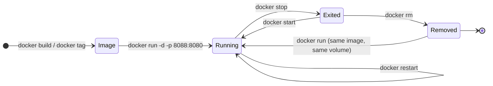
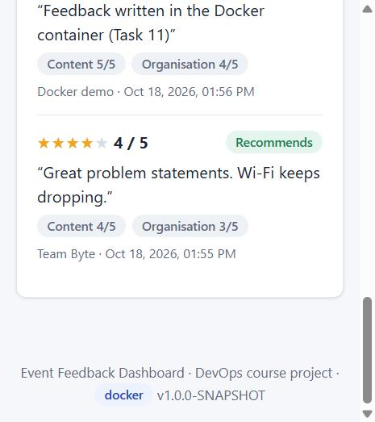

# Task 11 – Docker Image and Container Lifecycle

**Project:** Automated Event Feedback Dashboard · **Date:** 18-Oct-2026 · **Docker:** Docker Desktop 4.95, Engine 29.8.2 (Linux containers on WSL 2)

---

## 1. Goal

Package the application as a Docker image so it runs the same way on any machine with Docker, and practise the
full container lifecycle: build, tag, run, port mapping, logs, stop, start, restart, remove.



## 2. The Dockerfile

[`Dockerfile`](../Dockerfile) at the repository root:

```dockerfile
FROM eclipse-temurin:21-jre-alpine

ARG VERSION=dev
ARG REVISION=unknown
LABEL org.opencontainers.image.title="Event Feedback Dashboard" \
      org.opencontainers.image.source="https://github.com/vijayyh/event-feedback-dashboard" \
      org.opencontainers.image.version="${VERSION}" \
      org.opencontainers.image.revision="${REVISION}"

RUN addgroup -S efd && adduser -S -G efd -h /app efd \
    && mkdir -p /data && chown efd:efd /data
WORKDIR /app
COPY --chown=efd:efd target/event-feedback-dashboard.war app.war
USER efd

ENV SERVER_PORT=8080 APP_ENVIRONMENT=docker APP_DATA_DIR=/data \
    JAVA_TOOL_OPTIONS="-XX:MaxRAMPercentage=75 -XX:+ExitOnOutOfMemoryError"
EXPOSE 8080
VOLUME ["/data"]
HEALTHCHECK --interval=15s --timeout=5s --start-period=90s --retries=3 \
    CMD wget -qO- http://localhost:8080/actuator/health | grep -q '"status":"UP"' || exit 1
ENTRYPOINT ["java", "-jar", "/app/app.war"]
```

| Decision | Reason |
|----------|--------|
| Copies `target/event-feedback-dashboard.war` built by `mvn verify` | The image contains **exactly the artefact that passed the tests**: build once, deploy the same file everywhere. The WAR is executable (`java -jar`, embedded Tomcat). |
| `eclipse-temurin:21-jre-alpine` | Java 21 **runtime** only, no JDK or Maven. Alpine keeps the image small (130 MB compressed). |
| `USER efd` | The application does not run as root inside the container. |
| `VOLUME /data` + `APP_DATA_DIR=/data` | The H2 database lives outside the container, so data survives stop, remove and upgrade. |
| Settings through `ENV` | Spring Boot maps `APP_ENVIRONMENT` → `app.environment`, `SERVER_PORT` → `server.port`. The password is passed at run time with `-e SPRING_SECURITY_USER_PASSWORD`, never baked into the image. |
| `HEALTHCHECK` | Docker itself reports `starting` / `healthy` / `unhealthy`. The pipeline (Task 12) waits for `healthy`. |
| `JAVA_TOOL_OPTIONS` | The heap follows the container memory limit (75 %), and the JVM exits on out-of-memory so Docker can restart it. |
| OCI labels | Version and Git commit can be read from any image (`docker inspect`). |
| [`.dockerignore`](../.dockerignore) | The build context is only the WAR (`*` + `!target/event-feedback-dashboard.war`), which keeps it fast and free of secrets. |

## 3. Build and tag

```powershell
mvn -B clean verify                       # 51 unit/API + 9 Selenium tests, coverage gate, WAR
docker build -t event-feedback-dashboard:1.0.0-SNAPSHOT --build-arg VERSION=1.0.0-SNAPSHOT --build-arg REVISION=b94e898 .
docker tag event-feedback-dashboard:1.0.0-SNAPSHOT event-feedback-dashboard:b94e898
docker tag event-feedback-dashboard:1.0.0-SNAPSHOT event-feedback-dashboard:latest
```

### Image details

| Property | Value |
|----------|-------|
| Tags | `event-feedback-dashboard:1.0.0-SNAPSHOT`, `:b94e898` (Git commit), `:latest`, all the same image |
| Image ID | `sha256:00108cd455aac3f3d00e41361bfd5d22d5a3ff4c5976f99f19a3cde1526f0890` |
| Size | 130 MB compressed (content), 404 MB on disk |
| OS / architecture | linux/amd64 (Alpine 3.24, Temurin JDK 21.0.12 runtime) |
| User / workdir | `efd` / `/app` |
| Exposed port / volume | `8080/tcp` / `/data` |
| Entrypoint | `["java","-jar","/app/app.war"]` |
| Health check | `wget … /actuator/health` every 15 s, start period 90 s, 3 retries |
| Labels | `org.opencontainers.image.version=1.0.0-SNAPSHOT`, `revision=b94e898`, `source=https://github.com/vijayyh/event-feedback-dashboard` |

Layers (`docker history`): the application adds 62.2 MB (the WAR) and 41 kB (user and folders) on top of the
Temurin runtime (165 MB) and Alpine (9 MB).

## 4. Run with port mapping

```powershell
docker volume create efd-data
docker run -d --name efd-demo -p 8088:8080 --memory 512m -e SPRING_SECURITY_USER_PASSWORD -v efd-data:/data event-feedback-dashboard:1.0.0-SNAPSHOT
```

| Option | Meaning |
|--------|---------|
| `-d` | run in the background (detached) |
| `-p 8088:8080` | host port 8088 → container port 8080 (8080/8081 are already used by Jenkins and Tomcat) |
| `--memory 512m` | memory limit; the JVM heap becomes 75 % of it |
| `-e SPRING_SECURITY_USER_PASSWORD` | organiser password copied from the shell's environment, so the value never appears in the command or the log |
| `-v efd-data:/data` | named volume for the database |

```text
NAMES      IMAGE                                     STATUS                            PORTS
efd-demo   event-feedback-dashboard:1.0.0-SNAPSHOT   Up 2 seconds (health: starting)   0.0.0.0:8088->8080/tcp
efd-demo   event-feedback-dashboard:1.0.0-SNAPSHOT   Up 28 seconds (healthy)           0.0.0.0:8088->8080/tcp
```

From the host:

```text
> curl http://localhost:8088/api/info
{"name":"Event Feedback Dashboard","version":"1.0.0-SNAPSHOT","environment":"docker","javaVersion":"21.0.12.1",...}
> curl http://localhost:8088/actuator/health
{"status":"UP","components":{"db":{"status":"UP",...},"diskSpace":{"status":"UP",...},"ping":{"status":"UP"}}}
home page: HTTP 200, text/html;charset=UTF-8
```



## 5. Inspect logs and the running container

```text
> docker logs efd-demo --tail 12
... TomcatWebServer  : Tomcat started on port 8080 (http) with context path '/'
... EventFeedbackDashboardApplication : Started EventFeedbackDashboardApplication in 18.896 seconds
... DemoDataSeeder   : Seeded demo data: 5 events, 9 feedback entries
... AlertBackfill    : Alert backfill: evaluated existing feedback, raised 4 alerts

> docker stats efd-demo --no-stream
NAME       CPU %     MEM USAGE / LIMIT   MEM %     PIDS
efd-demo   0.31%     244.7MiB / 512MiB   47.79%    33

> docker exec efd-demo sh -c "id; ls -l /data"
uid=100(efd) gid=101(efd) groups=101(efd)
-rw-r--r-- 1 efd efd 40960 Oct 18 08:25 efd-db.mv.db

> docker top efd-demo
CMD: java -jar /app/app.war
```

To prove that data survives the lifecycle, one feedback entry was submitted through the API: the event's
`responseCount` went from **1 → 2**.

## 6. Stop, start, restart, remove

| Step | Command | Result |
|------|---------|--------|
| Stop | `docker stop efd-demo` | `Exited (143)`: SIGTERM, clean Spring shutdown. `curl` → no connection |
| Start | `docker start efd-demo` | `Up 26 seconds (healthy)`, `responseCount` still **2** |
| Restart | `docker restart efd-demo` | new `StartedAt`, healthy again. The log shows three starts but "Seeded demo data" only once, because the database is kept |
| Remove | `docker stop efd-demo` + `docker rm efd-demo` | container gone (`docker ps -a` empty); the volume `efd-data` remains |
| Re-create | `docker run -d --name efd-demo-2 --restart unless-stopped … -v efd-data:/data …` | a **new** container is healthy after 27 s, and `responseCount` is still **2**: "Feedback written in the Docker container (Task 11)" is still there |
| Clean up | `docker rm -f efd-demo-2`, `docker volume rm efd-data` | container and data removed; the image is kept for Task 12 |

`--restart unless-stopped` makes Docker start the container again after a crash or a Docker restart, unless it
was stopped on purpose.

## 7. Command log

The complete, unedited command log (every command with its output and time):
[`docs/evidence/task11-docker-commands.txt`](evidence/task11-docker-commands.txt).

## 8. Deliverables checklist

| Deliverable | Evidence |
|-------------|----------|
| Dockerfile | [`Dockerfile`](../Dockerfile), [`.dockerignore`](../.dockerignore), section 2 |
| Image details | Section 3: tags, ID, size, layers, labels, health check |
| Docker command log | Section 7: `docs/evidence/task11-docker-commands.txt` (272 lines) |
| Running container evidence | Sections 4–5: `docker ps` healthy, curl output, logs, stats, screenshot |
| Container lifecycle | Section 6: stop / start / restart / remove / re-create with persistent data |
