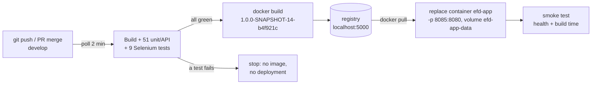
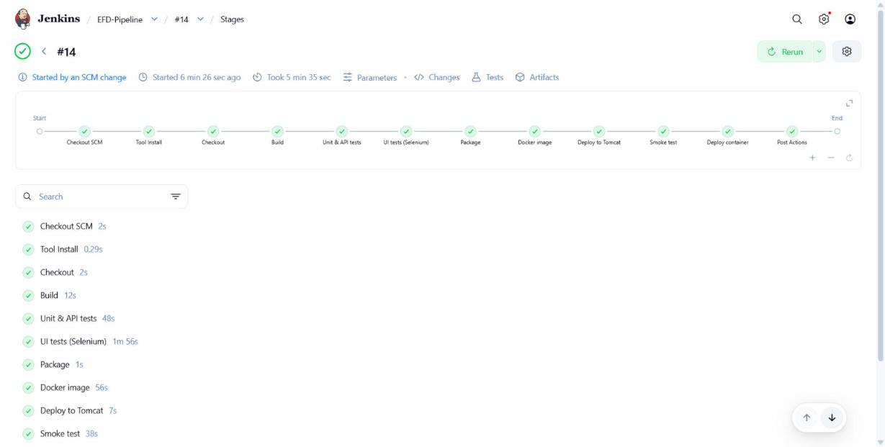
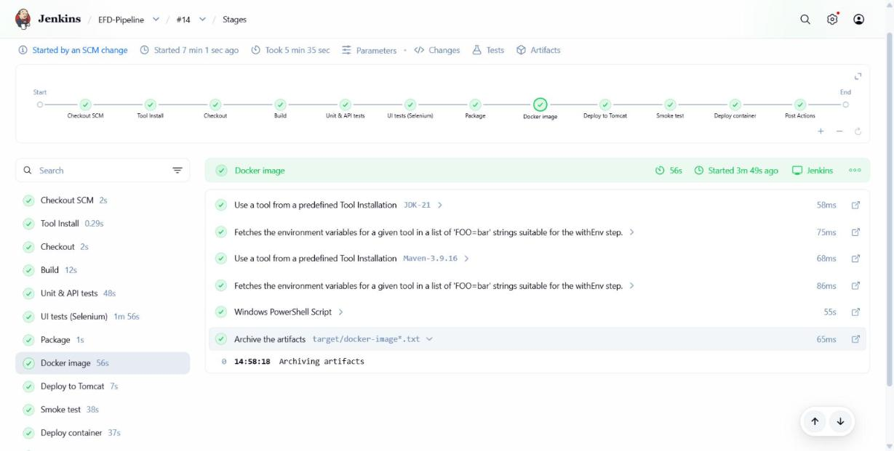
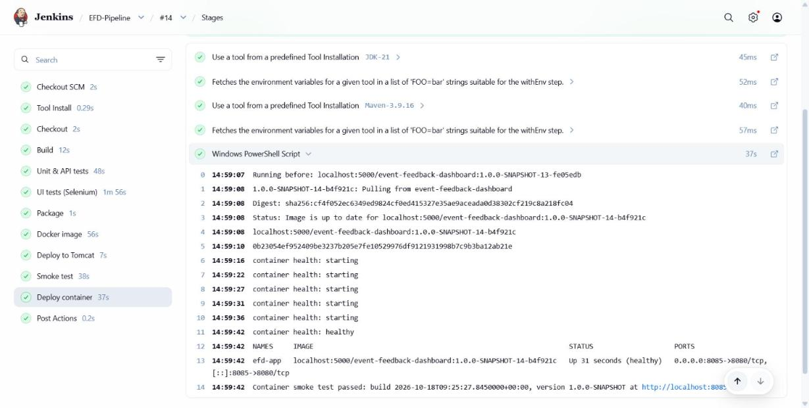
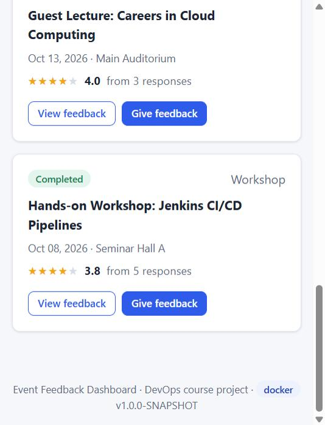

# Task 12 – Jenkins–Docker Continuous Deployment

**Project:** Automated Event Feedback Dashboard · **Date:** 18-Oct-2026 · **Jenkins job:** `EFD-Pipeline` · **Registry:** local Docker registry `localhost:5000`

---

## 1. Goal

Every commit on `develop` that passes all tests ends as a **versioned Docker image in a registry** and a **fresh
running container**, with no manual step: commit → test → image → registry → container.



## 2. Set-up

| Component | Configuration |
|-----------|---------------|
| Docker | Docker Desktop 4.95 (Engine 29.8.2, WSL 2 backend). Jenkins runs as `nt authority\system` and uses `C:\Program Files\Docker\Docker\resources\bin\docker.exe` (checked with a throw-away job: `docker version`, `docker ps`) |
| Registry | `docker run -d --name efd-registry --restart always -p 5000:5000 -v efd-registry-data:/var/lib/registry registry:2`. Private and local, so no account or password is needed. Images survive restarts in the volume |
| Dockerfile | the one from [Task 11](11-docker-image-and-container-lifecycle.md): Java 21 runtime + the tested WAR |
| New pipeline parameters | `REGISTRY` (default `localhost:5000`), `CONTAINER_PORT` (default `8085`) |

## 3. Pipeline changes

[`Jenkinsfile`](../Jenkinsfile), two new stages. Both run only when every earlier stage, including all tests, was
green:

```text
Checkout → Build → Unit & API tests → UI tests (Selenium) → Package → Docker image → Deploy to Tomcat → Smoke test → Deploy container
```

**Docker image**
- **Version tag** `<maven version>-<build number>-<commit>`, e.g. `1.0.0-SNAPSHOT-14-b4f921c`. Every image can be
  traced to the exact Jenkins build and Git commit. `latest` points to the newest one.
- `docker build` of the WAR built and tested in the same run, with build args `VERSION` and `REVISION` and the
  label `jenkins.build`.
- `docker push` of both tags. The stage then prints the image digest and the registry's tag list.
- The image name and digest are saved as build artefacts (`target/docker-image.txt`, `docker-image-digest.txt`).

**Deploy container**
- `docker pull <image>` from the registry, so we deploy what the registry serves rather than the build cache.
- The old `efd-app` container is removed and a **fresh** one started:
  - `--restart unless-stopped`, `--memory 512m`;
  - `-p 8085:8080`;
  - `-v efd-app-data:/data`, so the data survives the replacement;
  - `-e APP_ENVIRONMENT=docker`;
  - the organiser password comes from the Jenkins credential as `-e SPRING_SECURITY_USER_PASSWORD`, so its value
    never appears on a command line or in the log.
- **Smoke test** fails the build when any of these is wrong:
  - Docker reports `healthy` (from the image's `HEALTHCHECK`);
  - `/actuator/info` reports **this build's** build time;
  - `/api/info` reports environment `docker`.
- Housekeeping: keeps the 5 newest image tags locally. The registry keeps all of them.

## 4. End-to-end run: commit to container (EFD-Pipeline #14)

Started automatically by the merge of PR #49 (`b4f921c`), all 11 stages green in 5 min 35 s:



```text
Started by an SCM change
Checking out Revision b4f921c620bff6951664585f85508633375fe824 (refs/remotes/origin/develop)
[INFO] Tests run: 51, Failures: 0, Errors: 0, Skipped: 0
[INFO] Tests run: 9, Failures: 0, Errors: 0, Skipped: 0
-- Docker image
#5 [1/4] FROM docker.io/library/eclipse-temurin:21-jre-alpine@sha256:51ab5e33...
#8 [4/4] COPY --chown=efd:efd target/event-feedback-dashboard.war app.war
#9 naming to localhost:5000/event-feedback-dashboard:1.0.0-SNAPSHOT-14-b4f921c done
1.0.0-SNAPSHOT-14-b4f921c: digest: sha256:cf4f052ec6349ed9824cf0ed415327e35ae9aceada0d38302cf219c8a218fc04 size: 856
Published localhost:5000/event-feedback-dashboard:1.0.0-SNAPSHOT-14-b4f921c
Registry localhost:5000 now holds: 1.0.0-SNAPSHOT-14-b4f921c, 1.0.0-SNAPSHOT-12-9596f8f, 1.0.0-SNAPSHOT-13-fe05edb, latest
-- Deploy to Tomcat / Smoke test
Smoke test passed: 5 events served at http://localhost:8081/event-feedback-dashboard-staging/
-- Deploy container
Running before: localhost:5000/event-feedback-dashboard:1.0.0-SNAPSHOT-13-fe05edb
1.0.0-SNAPSHOT-14-b4f921c: Pulling from event-feedback-dashboard
container health: starting  (x5)
container health: healthy
NAMES     IMAGE                                                               STATUS                    PORTS
efd-app   localhost:5000/event-feedback-dashboard:1.0.0-SNAPSHOT-14-b4f921c   Up 31 seconds (healthy)   0.0.0.0:8085->8080/tcp
Container smoke test passed: build 2026-10-18T09:25:27.8450000+00:00, version 1.0.0-SNAPSHOT at http://localhost:8085/
Finished: SUCCESS
```

The container from build #13 (`…-13-fe05edb`) was **replaced automatically** by a fresh container from build
#14's image (`…-14-b4f921c`).

| Docker image stage | Deploy container stage |
|---|---|
|  |  |

## 5. Registry evidence

From [`docs/evidence/task12-registry-and-container.txt`](evidence/task12-registry-and-container.txt):

```text
> curl http://localhost:5000/v2/_catalog
{"repositories":["event-feedback-dashboard"]}

> curl http://localhost:5000/v2/event-feedback-dashboard/tags/list
{"name":"event-feedback-dashboard","tags":["1.0.0-SNAPSHOT-14-b4f921c","1.0.0-SNAPSHOT-12-9596f8f","1.0.0-SNAPSHOT-13-fe05edb","latest"]}

> curl -I .../v2/event-feedback-dashboard/manifests/1.0.0-SNAPSHOT-14-b4f921c
Content-Type: application/vnd.oci.image.index.v1+json
Docker-Content-Digest: sha256:cf4f052ec6349ed9824cf0ed415327e35ae9aceada0d38302cf219c8a218fc04   <- same digest as in the pipeline log
```

| Tag | Jenkins build | Commit | Digest |
|-----|---------------|--------|--------|
| `1.0.0-SNAPSHOT-12-9596f8f` | #12 | `9596f8f` (PR #47) | `sha256:151e37f5…` |
| `1.0.0-SNAPSHOT-13-fe05edb` | #13 | `fe05edb` (PR #48) | `sha256:40e7fad8…` |
| `1.0.0-SNAPSHOT-14-b4f921c` = `latest` | #14 | `b4f921c` (PR #49) | `sha256:cf4f052e…` |

## 6. The running container

```text
> docker ps
NAMES          IMAGE                                                               STATUS                        PORTS
efd-app        localhost:5000/event-feedback-dashboard:1.0.0-SNAPSHOT-14-b4f921c   Up About a minute (healthy)   0.0.0.0:8085->8080/tcp
efd-registry   registry:2                                                          Up 58 minutes                 0.0.0.0:5000->5000/tcp

> docker inspect efd-app
localhost:5000/event-feedback-dashboard:1.0.0-SNAPSHOT-14-b4f921c | restart=unless-stopped | memory=536870912 | health=healthy
{"jenkins.build":"14","org.opencontainers.image.revision":"b4f921c","org.opencontainers.image.version":"1.0.0-SNAPSHOT",...}
efd-app-data -> /data

> curl http://localhost:8085/actuator/info
{"build":{"time":"2026-10-18T09:25:27.845Z","version":"1.0.0-SNAPSHOT",...}}
```



## 7. Problems found on the way

| Run | What happened | Fix |
|-----|---------------|-----|
| Dry run before the merge | `docker build` from the pipeline script: `docker-credential-desktop: executable file not found` | The Docker stages put Docker's `bin` folder on `PATH` (`c2148e4`) |
| **#12**, first real run | Tests green and image **pushed**, then reading the registry's tag list failed: `Invalid URI: The hostname could not be parsed`. Deployment was skipped, as designed. `REGISTRY` was added as a parameter in the same commit, and Jenkins does not export a new parameter as an environment variable on its first run | The stages read `DOCKER_REGISTRY` and `APP_PORT`, set from `params` in the `environment` block. Docker's progress output is printed as plain text instead of `NativeCommandError` records (PR #48) |
| **#13** | Commit → container green end to end | – |
| **#14** | Container replaced by a fresh one from the new image (section 4) | – |

## 8. Deliverables checklist

| Deliverable | Evidence |
|-------------|----------|
| Versioned image | `localhost:5000/event-feedback-dashboard:1.0.0-SNAPSHOT-14-b4f921c` (version-build-commit tag, OCI labels, digest) – sections 3–5 |
| Registry evidence | Section 5: catalog, tag list, manifest digest; [`task12-registry-and-container.txt`](evidence/task12-registry-and-container.txt) |
| End-to-end commit-to-container pipeline | Section 4: build #14 started by an SCM change, tests, image, push, fresh container, smoke test; screenshots |
| Fresh container after successful tests | `Running before: …-13-fe05edb` → new `efd-app` from `…-14-b4f921c`; failed tests skip the Docker stages (same `when` guard as the Tomcat deployment, proven in Task 10) |
