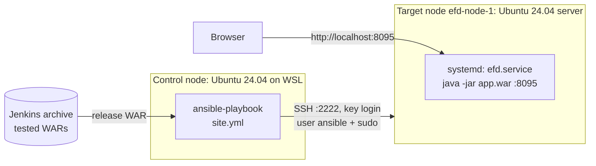
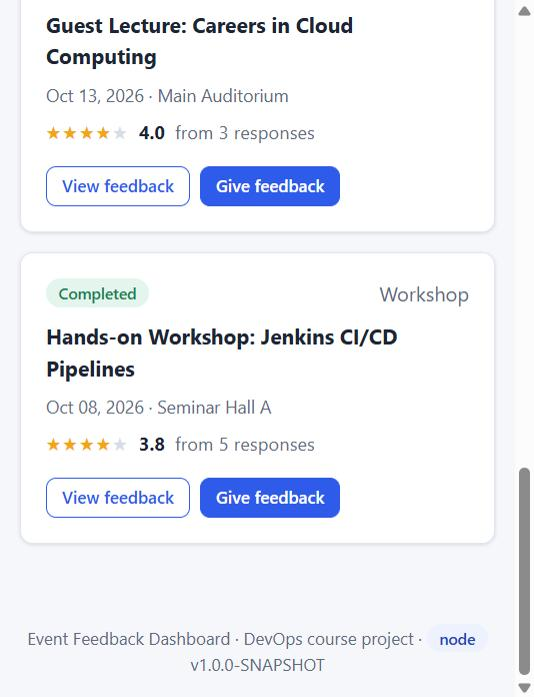

# Task 13 – Configuration Management with Ansible

**Project:** Automated Event Feedback Dashboard · **Date:** 18-Oct-2026 · **Tool:** Ansible (ansible-core 2.16.3)

---

## 1. Goal

Describe everything a server needs to run the Event Feedback Dashboard. Write it down **as code**, so any new
server can be configured identically by one command instead of a manual checklist.



| Role | Machine |
|------|---------|
| Control node | Ubuntu 24.04 on WSL 2 (`Ubuntu-24.04`) with Ansible 2.16 from the Ubuntu packages |
| Target node | `efd-node-1`, a bare Ubuntu 24.04 server: systemd + SSH + Python. It runs as a container created by `provision.yml` (Task 14). SSH is reachable on port 2222 and the application on 8095 |
| Connection | SSH with an Ed25519 key (`~/.ssh/efd_node_ed25519`), user `ansible`, passwordless `sudo` (`become: true`) |

## 2. Configuration specification

These are all the prerequisites of an Event Feedback Dashboard server. Each row is implemented by the playbook
(column "Where").

### Packages

| Package | Why | Where |
|---------|-----|-------|
| `openjdk-21-jre-headless` | Java 21 runtime: the application is built for Java 21. No JDK or Maven on the server | role `java` |
| `ca-certificates`, `curl` | HTTPS trust store; manual health checks | role `common` |
| `logrotate` | rotates the application log | role `common` |
| `tzdata` | time zones for log timestamps | role `common` |
| `python3`, `openssh-server`, `sudo` | needed by Ansible itself; part of the base server | node image |

### Users and groups

| Account | Type | Settings |
|---------|------|----------|
| `efd` (group `efd`) | system user that runs the application | no password, shell `/usr/sbin/nologin`, home `/var/lib/efd`. Least privilege: it can write only its data and log folders |
| `ansible` | administrator used by Ansible | key-based SSH login only, passwordless `sudo` (comes with the base server image) |

### Folders

| Path | Owner : group | Mode | Content |
|------|---------------|------|---------|
| `/opt/efd` | root : root | 0755 | installation root |
| `/opt/efd/releases/<release>/` | root : root | 0755 | one immutable folder per release: `app.war` and `release.properties` |
| `/opt/efd/current` | symlink | – | points to the active release; a rollback is a link switch |
| `/opt/efd/previous` | root : root | 0644 | name of the release that was active before (used by `rollback.yml`) |
| `/etc/efd` | root : efd | 0750 | settings shared by all releases |
| `/var/lib/efd` | efd : efd | 0750 | H2 database (`efd-db.mv.db`) |
| `/var/log/efd` | efd : efd | 0750 | application log `efd.log` |

### Files

| File | Owner, mode | Content | Template |
|------|-------------|---------|----------|
| `/etc/efd/efd.env` | root:efd 0640 | `SERVER_PORT=8095`, `APP_ENVIRONMENT=node`, `APP_DATA_DIR=/var/lib/efd`, `JAVA_OPTS`, `SPRING_SECURITY_USER_PASSWORD`. Readable by the service only; the task runs with `no_log` | `efd.env.j2` |
| `/etc/systemd/system/efd.service` | root 0644 | systemd unit (below) | `efd.service.j2` |
| `/etc/logrotate.d/efd` | root 0644 | daily rotation, 14 days, compressed, `copytruncate` | inline |
| `/opt/efd/releases/<release>/app.war` | root:efd 0644 | the WAR that Jenkins built and tested (archived artefact) | copied |
| `/opt/efd/releases/<release>/release.properties` | root:efd 0644 | settings that ship with this release (normally empty) | `release.properties.j2` |

### Ports

| Port | Protocol | Service | Exposed as |
|------|----------|---------|------------|
| 8095 | HTTP | Event Feedback Dashboard (`/`, `/api/*`, `/actuator/health`) | `localhost:8095` |
| 22 | SSH | administration by Ansible | `localhost:2222` |

### Services

| Service | State | Settings |
|---------|-------|----------|
| `efd.service` | enabled, running | `User=efd`, `EnvironmentFile=/etc/efd/efd.env`, `ExecStart=/usr/bin/java $JAVA_OPTS -jar /opt/efd/current/app.war --spring.config.additional-location=optional:file:/opt/efd/current/release.properties`, `Restart=on-failure`, `RestartSec=5`, `SuccessExitStatus=143`, log appended to `/var/log/efd/efd.log` |
| `ssh.service` | enabled, running | part of the base server |

### Secrets

The organiser password never appears in Git, in the inventory or in a log:
1. `ansible/run.ps1` reads it from the git-ignored `application-local.properties`.
2. It passes the value to WSL in the environment variable `EFD_ORGANISER_PASSWORD`, through `WSLENV`.
3. `group_vars` reads it with `lookup('env', …)`.
4. Ansible writes it only into `/etc/efd/efd.env` (mode 0640, task with `no_log: true`).

A check of all evidence logs for the password found **0** matches.

## 3. Ansible project

```text
ansible/
├── ansible.cfg                 inventory, roles path, YAML output, SSH pipelining
├── inventory/hosts.yml         group efd_servers: efd-node-1 (127.0.0.1:2222, user ansible, key)
├── group_vars/efd_servers.yml  environment-specific values: port 8095, environment "node", JVM options,
│                               password lookup, release = Jenkins build number
├── site.yml                    configure the servers and deploy the release (roles common, java, efd_app)
├── provision.yml               create a clean node (Task 14)
├── health.yml                  health check (Task 14)
├── rollback.yml                manual rollback (Task 14)
├── recovery-test.yml           crash-recovery test (Task 14)
├── releases/bad-release.yml    deliberately broken release for the rollback test (Task 14)
├── roles/
│   ├── common/tasks/main.yml   package index, base packages
│   ├── java/tasks/main.yml     Java 21 runtime, version check
│   └── efd_app/
│       ├── defaults/main.yml   user, folders, port, release paths, health check
│       ├── tasks/setup.yml     group, user, folders, env file, systemd unit, logrotate
│       ├── tasks/deploy.yml    release folder, WAR, release settings, switch, restart, health check,
│       │                       automatic rollback (block/rescue)
│       └── templates/          efd.env.j2, efd.service.j2, release.properties.j2
├── node/Dockerfile             the bare Ubuntu 24.04 server image (Task 14)
├── run.sh                      runs a playbook on the control node
└── run.ps1                     Windows wrapper: password via WSLENV, log file
```

`site.yml`:

```yaml
- name: Configure Event Feedback Dashboard servers
  hosts: efd_servers
  become: true
  roles:
    - common
    - java
    - efd_app
```

Design choices:
- **Idempotent modules** (`apt`, `user`, `file`, `template`, `copy`, `systemd`, `uri`). Read-only commands are marked
  `changed_when: false`. The service is restarted **only** when the release, its settings, the environment file
  or the unit changed. So a second run changes nothing (proved in Task 14).
- **Releases are immutable folders** and `current` is a symlink. Deploying a new version never overwrites the old
  one, which makes rollback instant.
- **Release = archived Jenkins artefact.** `efd_release_build: 13` takes
  `…/EFD-Pipeline/builds/13/archive/target/event-feedback-dashboard.war`, the WAR that passed every test in the
  pipeline.
- **Health check after every (re)start** (`uri` on `/actuator/health`, up to 2 min). If it fails, the `rescue`
  block reactivates the previous release (Task 14).

Run it:

```powershell
.\ansible\run.ps1 site.yml                                   # release from group_vars (Jenkins build 13)
.\ansible\run.ps1 site.yml -Options '-e','efd_release_build=11'   # another archived build
```

## 4. First execution

**Before.** The node created by `provision.yml` is a bare server
([`task13-00-node-before.txt`](evidence/task13-00-node-before.txt)):

```text
--- OS:               Ubuntu 24.04.5 LTS (6.6.87.2-microsoft-standard-WSL2)
--- init (PID 1):     systemd
--- java:             not installed
--- service user efd: id: 'efd': no such user
--- folder /opt/efd: missing   (/etc/efd, /var/lib/efd, /var/log/efd: missing)
--- service efd:      inactive
--- service ssh:      active
--- listening ports:  0.0.0.0:22 [::]:22
--- packages:         145 installed
```

**First run** of `site.yml` with release `build-11` (full log: [`task13-first-run.txt`](evidence/task13-first-run.txt)):

```text
# 2026-10-18 14:41:00 IST ansible-playbook site.yml -e efd_release_build=11 (ansible-core 2.16.3)

TASK [common : Install base packages] ............................ changed
TASK [java : Install the Java 21 runtime] ........................ changed
TASK [java : Show the Java version] .............................. openjdk version "21.0.12.1" 2026-08-18
TASK [efd_app : Create the service group] ........................ changed
TASK [efd_app : Create the service user (no login shell, no password)] changed
TASK [efd_app : Create the application folders] .................. changed: /opt/efd, /opt/efd/releases,
                                                                   /etc/efd, /var/lib/efd, /var/log/efd
TASK [efd_app : Write the settings shared by every release] ...... changed (no_log)
TASK [efd_app : Install the systemd service] ..................... changed
TASK [efd_app : Rotate the application log daily, keep 14 days] .. changed
TASK [efd_app : Create the release folder build-11] .............. changed
TASK [efd_app : Copy the release WAR (archived by Jenkins)] ...... changed
TASK [efd_app : Write the settings that ship with this release] .. changed
TASK [efd_app : Point /opt/efd/current to build-11] .............. changed
TASK [efd_app : Restart the service because the release or its settings changed] changed
TASK [efd_app : Health check http://127.0.0.1:8095/actuator/health]
FAILED - RETRYING: ... (24 retries left)       <- Spring Boot is still starting
FAILED - RETRYING: ... (23 retries left)
FAILED - RETRYING: ... (22 retries left)
ok: [efd-node-1]
TASK [efd_app : Show the active release]
    msg: 'efd-node-1 runs build-11 (1.0.0-SNAPSHOT, built 2026-10-18T08:34:07.736Z): health UP on port 8095'

PLAY RECAP
efd-node-1  : ok=25   changed=13   unreachable=0    failed=0    skipped=1    rescued=0    ignored=0
```

The node now meets the whole specification: Java 21, user `efd`, five folders, three managed files, `efd.service`
enabled and running, port 8095 healthy.



## 5. Deliverables checklist

| Deliverable | Evidence |
|-------------|----------|
| Configuration specification (packages, users, folders, files, ports, services) | Section 2 |
| Ansible inventory | [`ansible/inventory/hosts.yml`](../ansible/inventory/hosts.yml), [`ansible/group_vars/efd_servers.yml`](../ansible/group_vars/efd_servers.yml) |
| YAML playbook (+ roles) | [`ansible/site.yml`](../ansible/site.yml), [`ansible/roles/`](../ansible/roles) – section 3 |
| First execution log | Section 4, [`docs/evidence/task13-first-run.txt`](evidence/task13-first-run.txt) |
