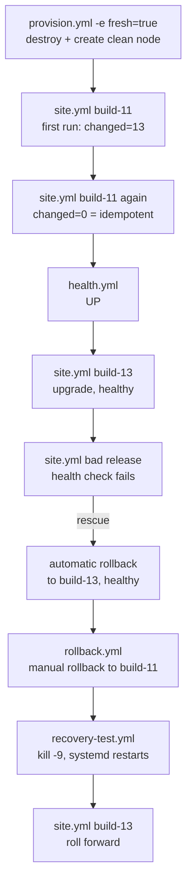

# Task 14 – Automated Provisioning and Reliability Validation

**Project:** Automated Event Feedback Dashboard · **Date:** 18-Oct-2026 · **Tool:** Ansible 2.16 + Docker (node runtime)

---

## 1. Goal

Prove that the automation from Task 13 is **reliable**:
1. A clean server can be created and configured from nothing, by commands only.
2. Running the automation again changes nothing (idempotency).
3. The application is healthy.
4. A bad release is undone automatically, and the previous stable release can be restored on demand.
5. The service recovers from a crash by itself.



All runs were made from Windows with `.\ansible\run.ps1 <playbook> -Log docs\evidence\…`. Each log starts
with the exact command and time.

## 2. Provisioning a clean target node

`provision.yml` (play on `localhost`, the control node) creates the target node:

1. Creates the control node's SSH key pair (once).
2. Builds the **bare server image** [`ansible/node/Dockerfile`](../ansible/node/Dockerfile): Ubuntu 24.04 with
   only systemd, OpenSSH, Python 3 and the administrator `ansible`, like a freshly installed cloud server.
   `--provenance=false` makes a cached rebuild produce the same image ID.
3. With `-e fresh=true`, **destroys the existing node**, so the next steps start from a blank machine.
4. Starts a node container from the image:
   - systemd runs as PID 1 (`--privileged --cgroupns=host`);
   - `-p 2222:22 -p 8095:8095`;
   - `--memory 1g`.
5. Authorises the control node's public key for `ansible` and waits until SSH answers.
6. Second play: gathers facts **over SSH** to prove that Ansible can manage the node.

```text
# 2026-10-18 14:39:53 IST ansible-playbook provision.yml -e fresh=true
TASK [Build the clean node image (bare Ubuntu 24.04 server)] ...... ok      (cache: same image)
TASK [Destroy the existing node (fresh=true)] ..................... changed
TASK [Start a new node container from the clean image] ............ changed
TASK [Authorise the control node's public key for the ansible account] changed
TASK [Wait until the node accepts SSH connections] ................ ok
TASK [Show the node]
    msg: 'efd-node-1: Ubuntu 24.04, kernel 6.6.87.2-microsoft-standard-WSL2, 2909 MB RAM, 2 vCPU,
          init system systemd, Python 3.12.3'
PLAY RECAP
efd-node-1 : ok=2  changed=0  failed=0
localhost  : ok=9  changed=3  failed=0  skipped=1
```

State of the new node before configuration ([`task13-00-node-before.txt`](evidence/task13-00-node-before.txt)):
- no Java, no `efd` user, none of the application folders;
- `efd` inactive, only SSH listening;
- 145 packages installed.

Provisioning is idempotent as well. Running `provision.yml` again on the existing node gives
`localhost: changed=0`, `efd-node-1: changed=0`
([`task14-02-provision-second-run.txt`](evidence/task14-02-provision-second-run.txt)).

Logs: [`task14-01-provision-clean-node.txt`](evidence/task14-01-provision-clean-node.txt).

## 3. Deploy the application

`site.yml` configures the node and deploys release `build-11`, the WAR from Jenkins build #11. This is the first
execution documented in [Task 13](13-configuration-management-ansible.md#4-first-execution):
`ok=25 changed=13`, health `UP`.

## 4. Idempotency

The same command a second time ([`task14-03-site-second-run-idempotency.txt`](evidence/task14-03-site-second-run-idempotency.txt)):

```text
# 2026-10-18 14:43 IST ansible-playbook site.yml -e efd_release_build=11
...
    msg: 'efd-node-1 runs build-11 (1.0.0-SNAPSHOT, built 2026-10-18T08:34:07.736Z): health UP on port 8095'
PLAY RECAP
efd-node-1                 : ok=23   changed=0    unreachable=0    failed=0    skipped=3    rescued=0    ignored=0
```

**`changed=0`**. Every package, user, folder, file, link and service was already in the wanted state, so nothing
was touched, and the service was **not** restarted. This works because:
- only declarative modules are used;
- read-only commands are marked `changed_when: false`;
- the restart is conditional on a real change.

## 5. Health check

`health.yml` checks the service, the ports and the application, and fails if any of them is wrong
([`task14-04-health-check.txt`](evidence/task14-04-health-check.txt)):

```text
TASK [Result]
    msg:
    - 'service efd: active'
    - 'listening: *:8095, 0.0.0.0:22, [::]:22'
    - 'health: UP (db UP, disk UP)'
    - 'release: build-11 = 1.0.0-SNAPSHOT built 2026-10-18T08:34:07.736Z'
    - 'environment: node, Java 21.0.12.1'
PLAY RECAP
efd-node-1                 : ok=7    changed=0    unreachable=0    failed=0
```

The same checks from the Windows host through the published port
([`task14-10-host-check.txt`](evidence/task14-10-host-check.txt)):

```text
> curl http://localhost:8095/actuator/health  -> {"status":"UP","components":{"db":{"status":"UP",...},"diskSpace":{"status":"UP",...}}}
> curl http://localhost:8095/api/info         -> {"version":"1.0.0-SNAPSHOT","environment":"node","javaVersion":"21.0.12.1",...}
> curl http://localhost:8095/actuator/info    -> {"build":{"time":"2026-10-18T08:52:33.961Z","version":"1.0.0-SNAPSHOT",...}}
home page: HTTP 200, text/html;charset=UTF-8
```

## 6. Upgrade to a new release

`site.yml` with the default release `build-13` (Jenkins build #13, the first fully green Docker-pipeline build)
([`task14-05-upgrade-to-build-13.txt`](evidence/task14-05-upgrade-to-build-13.txt)):

```text
TASK [efd_app : Point /opt/efd/current to build-13] ............... changed
TASK [efd_app : Restart the service because the release or its settings changed] changed
TASK [efd_app : Health check http://127.0.0.1:8095/actuator/health] ok
TASK [efd_app : Record the release that was active before (only after a healthy switch)] changed  -> previous = build-11
    msg: 'efd-node-1 runs build-13 (1.0.0-SNAPSHOT, built 2026-10-18T08:52:33.961Z): health UP on port 8095'
PLAY RECAP
efd-node-1                 : ok=25   changed=6    failed=0
```

Only the release-specific steps changed. The Java, user, folder and file tasks stayed `ok`.

## 7. Rollback and recovery

### 7.1 Automatic rollback of a bad release

[`ansible/releases/bad-release.yml`](../ansible/releases/bad-release.yml) is a **deliberately broken release** for
this test. It uses the same WAR as build 13 but ships with a wrong database URL
(`spring.datasource.url=jdbc:h2:tcp://db.invalid:9092/efd`).

`deploy.yml` puts activation and health check in a `block`. If the health check fails, the `rescue` section:
1. points `current` back at the previous release;
2. restarts the service;
3. checks its health again;
4. ends the run as **failed**, so a CI system would notice.

([`task14-06-bad-release-automatic-rollback.txt`](evidence/task14-06-bad-release-automatic-rollback.txt))

```text
# ansible-playbook site.yml -e @releases/bad-release.yml
TASK [efd_app : Point /opt/efd/current to build-13-bad-db] ......... changed
TASK [efd_app : Restart the service because the release or its settings changed] changed
TASK [efd_app : Health check http://127.0.0.1:8095/actuator/health]
FAILED - RETRYING: ... (12 retries left)
...
FAILED - RETRYING: ... (1 retries left)
fatal: [efd-node-1]: FAILED! => msg: 'Status code was -1 and not [200]: Request failed: <urlopen error [Errno 111] Connection refused>'
TASK [efd_app : ROLLBACK: build-13-bad-db failed its health check, reactivating build-13] changed
TASK [efd_app : ROLLBACK: restart the service on build-13] ........ changed
TASK [efd_app : ROLLBACK: health check of build-13] ............... ok   (after 3 retries)
TASK [efd_app : Report the failed deployment]
fatal: [efd-node-1]: FAILED! => msg: Release build-13-bad-db did not become healthy.
                                     Rolled back to build-13, which is healthy again.
PLAY RECAP
efd-node-1                 : ok=24   changed=7    unreachable=0    failed=1    skipped=1    rescued=1    ignored=0
```

Why it failed, from the node's application log
([`task14-06b-bad-release-log.txt`](evidence/task14-06b-bad-release-log.txt)):

```text
ERROR ... SqlExceptionHelper : Connection is broken: "java.net.UnknownHostException: db.invalid: Name or service not known"
--- releases on the node: build-11  build-13  build-13-bad-db
--- current -> /opt/efd/releases/build-13
--- previous: build-11          <- untouched, because the bad release never became healthy
```

### 7.2 Manual rollback to the previous stable release

`rollback.yml` reactivates the release recorded in `/opt/efd/previous`, restarts the service and checks its health
([`task14-07-manual-rollback.txt`](evidence/task14-07-manual-rollback.txt)):

```text
TASK [Switch current from build-13 to build-11] ................... changed
TASK [Remember build-13 as the previous release] .................. changed
TASK [Restart the service] ........................................ changed
TASK [Health check] ............................................... ok
    msg: 'efd-node-1 runs build-11 again (was build-13): health UP'
PLAY RECAP
efd-node-1                 : ok=10   changed=3    failed=0
```

Rolling back takes seconds: the old release folder is still on the node, so nothing is downloaded or rebuilt.

### 7.3 Recovery after a crash

`recovery-test.yml` kills the Java process with `SIGKILL`, the way the kernel kills a process that runs out of
memory. It then checks that systemd (`Restart=on-failure`) brings the service back without any human help
([`task14-08-recovery-test.txt`](evidence/task14-08-recovery-test.txt)):

```text
TASK [Simulate a crash (SIGKILL to the Java process 5634)] ......... changed
TASK [Wait until systemd has restarted the service and it is healthy again] ok
    msg:
    - 'before: PID 5634, restarts 0'
    - 'right after SIGKILL: HTTP -1 (down)'
    - 'after:  PID 5803, restarts 1, health UP'
```

### 7.4 Roll forward

`site.yml` (release `build-13`) brings the node back to the newest stable release: `changed=3`, health UP
([`task14-09-roll-forward-to-build-13.txt`](evidence/task14-09-roll-forward-to-build-13.txt)).

## 8. Problems found while building the automation

| Problem | Cause | Fix |
|---------|-------|-----|
| `docker build` from WSL: `docker-credential-desktop: executable file not found` | The terminal that started WSL had been opened before Docker Desktop was installed, so its Windows `PATH` lacked Docker's folder | `run.ps1` reloads `PATH` from the system settings before calling WSL |
| `[Errno 8] Exec format error` when Ansible ran `docker.exe`, but only after a new node had booted | The node runs systemd **privileged**. Its `systemd-binfmt.service` reset the kernel's `binfmt_misc` table, which the whole WSL VM shares, and removed WSL's interop entry for Windows programs | The node image masks `systemd-binfmt.service` and its mount units. `run.sh` restores WSL's standard entry if anything else removes it |
| `provision.yml` reported `changed` on every run | Docker Desktop adds a provenance attestation with the build time, so each build had a new image ID | `docker build --provenance=false` for the node image |

## 9. Deliverables checklist

| Deliverable | Evidence |
|-------------|----------|
| Provisioned node | Section 2: `provision.yml -e fresh=true`, node facts over SSH, before/after state |
| Idempotency evidence | Section 4: `site.yml` second run `changed=0`; `provision.yml` second run `changed=0` |
| Health-check result | Section 5: `health.yml` and host `curl` checks, all UP |
| Rollback / recovery demonstration | Section 7: automatic rollback of a bad release, manual rollback to the previous stable release, crash recovery by systemd, roll forward |
